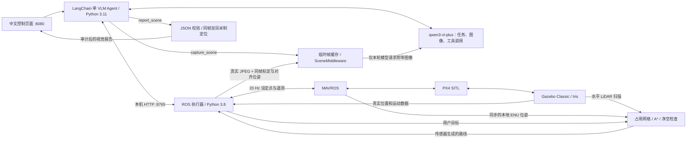

# PX4 仿真无人机 Agent

新机器部署见 [GitHub 安装说明](docs/GITHUB_SETUP.md)，上游源码及许可证范围见 [第三方声明](THIRD_PARTY_NOTICES.md)。本仓库保留项目源码、场景素材及已修改的 VINS-Fusion 源码；本机密钥、实验原始日志、虚拟环境、Catkin 构建输出和预编译动态库不随源码上传。下文引用的 `logs/` 历史证据保留在开发机，克隆仓库后需重新构建并独立验收。最新阶段结果见 [实施报告](docs/ordered_implementation_status.md)。

在本机打开中文控制页面，输入自然语言任务，通过 LangChain Agent 控制 Gazebo 中的 Iris。页面提供航迹监测、左右机载相机实时预览、视觉分析、任务步骤和执行结果，以及 PX4 的连接、模式、解锁和落地状态。现在默认使用 **单 VLM Agent**：`qwen3-vl-plus` 同时理解任务、查看真实机载图像和调用受限工具，ROS / PX4 独立执行飞行控制。

单 VLM 的实现与边界见 [单 VLM 架构说明](docs/single_vlm_architecture.md)。原先 `deepseek-v3.2` 规划、`qwen3-vl-plus` 独立分析图像的方案已整理为 [双模型基线文档](docs/dual_model_architecture.md)，可用 `AGENT_ARCHITECTURE=dual_model` 回退。单 VLM 已通过真实网页观察、起飞→图像观察→降落的混合任务，以及基础飞行和直接控制验收，见 [单 VLM 验收报告](logs/single_vlm/validation.json)。

运行环境为 Ubuntu 20.04、ROS Noetic、Gazebo Classic 11、PX4 v1.14。模型提交任务，ROS 执行器经 MAVROS 持续发送设定点，PX4 本地定位负责飞行控制；页面的仿真运动数据来自 `/gazebo/model_states`。默认 `ev_profile:=shadow` 独立验证 VINS-Fusion；实验配置 `gps_fused` 与 `no_gps` 将 VIO 接入 EKF2，并检查实际融合、时间戳和坐标重置。完整 shadow 试飞已通过，融合试飞及无 GPS 验收的当前进度和失败记录见 [VIO 融合与搜索](docs/vio_fusion_and_search.md)。



## 整套 launch 启动（默认打开 Gazebo 窗口）

### 本机桌面控制（无需浏览器）

本机已增加 Qt 桌面控制台，共用现有任务审计与执行器，可输入自然语言任务、选择只观察、查看遥测/双目图像/航迹，并直接悬停或降落。首次安装桌面依赖后，用以下入口一次启动仿真和控制窗口：

```bash
cd /home/fxxk/px4_agent
bash scripts/setup_agent.sh --desktop  # 首次安装；当前机器已完成
bash scripts/launch_desktop.sh
```

也可双击桌面上的 **PX4 桌面控制台** 快捷方式；Ubuntu 若提示不信任启动器，右键选择“允许启动”。本机也已注册应用菜单入口，可按 Super 键搜索 **PX4 桌面控制台**，避免文件管理器将 `.desktop` 当文本打开。启动终端会保留错误，完整启动输出另存于 `logs/desktop-launch-*.log`。桌面模式不启动网页服务，也不占用 8080 端口。停止旧系统后再启动这套入口。

桌面快捷方式现默认使用 **VIO 主定位**：`no_gps` profile 关闭 GPS 位置/高度融合，使用外部视觉位置、速度及视觉高度参考，保留气压计与磁罗盘辅助；只有实际 EKF 融合证据通过后才打开控制台。界面区分“VIO 仅监测”和“VIO 主定位”，不会仅凭 VINS 输出声称已用于飞控。

桌面默认使用已校验的**静态三维碰撞地图**规划，支持本地 ENU 高度 **1～10 米**、任务中升降，5 米仅为建议巡检高度。例如：“起飞到5米，升到10米，再到ENU坐标(1,0,8)，然后返航降落。”执行器独立检查三维路径和障碍物间隙。该模式依赖当前已知静态 Gazebo 场景，不是实时三维雷达建图，也不保证动态障碍保护；地图注册仅对本架次有效。

单 VLM 在该模式下支持自主目标搜索，例如“找到前方的油桶，拍照分析并报告周围的情况”。这类任务授权自主起飞、调整高度、横移与推进，无需提供 ENU 路线或逐步确认；“前方”取任务开始时的机头方向。每轮保存真实照片报告，再由模型依据遮挡/视野选择新观察策略；工具先检查候选三维路径，执行器负责避障。默认初始建议高度 3 米，搜索限制为起点水平半径 12 米、最多 8 次有效观察和 15 分钟，完成或预算结束后返航降落；明确要求悬停时保留悬停。纯“描述当前画面”仍只观察。视觉发现与双目米制定位分开，找到了但测不准位置时仍会报告图像证据。实现与验证见 [自主搜索说明](docs/autonomous_target_search.md)。

静态三维模式巡航现默认 0.65 米/秒，接近观察点或跟随落后时减速至 0.25 米/秒；自主搜索使用合并的换位采图工具，减少模型往返。二维雷达模式保留原速度。当前记忆仍以内存对话、任务工作记忆和短期图像缓存为主，没有自动长期检索；具体边界与耗时记录见 [性能与记忆说明](docs/performance_and_memory.md)。

模型上下文默认将旧任务转换为最多 8 轮、6000 字符的结构化摘要，当前指令及工具链完整保留；摘要从已保存结果直接生成，不额外调用模型，也不改写完整检查点与审计。历史追问依据旧报告回答，不自动重飞或重拍。实现与对照验证见 [任务上下文记忆](docs/task_context_memory.md)。

需要复用旧的固定高度雷达模式时，可执行 `UAV_NAVIGATION_MODE=lidar_grid PX4_DESKTOP_EV_PROFILE=shadow bash scripts/launch_desktop.sh`。这些桌面默认值不改变普通 ROS launch 的 `shadow` / 二维雷达默认行为。

统一 launch 支持 `control_ui:=desktop`，默认仍为 `web`。仅连接已运行的执行器时使用 `bash scripts/start_desktop.sh --env-file "$PWD/.env"`，不会另起仿真。窗口的关闭按钮在已知飞行中或有活动任务时，会询问是否中断并降落，确认落地上锁后再关闭；受管理器启动的整套系统随后正常清理。管理器收到 Ctrl+C 时会先中止桌面 Agent，再请求执行器降落并等待落地上锁，之后才关闭定位与仿真。

关闭启动终端也会执行完整退出流程；清理日志单独写入本次运行目录的 `cleanup.log`，不依赖终端是否仍打开。退出后立即再次双击时，启动器会等待上一轮清理及 ROS master 退出，再启动新系统。

自然语言和视觉任务需要 `.env` 中配置模型密钥。状态显示、停止/悬停和立即降落不需要模型；网络请求在后台线程执行，过期相机画面会清除。当前新增窗口测试使用模拟执行器验证，不代表新的真实飞行验收。

桌面使用 Qt 6、Noto Sans CJK 中文字体和平滑渲染，支持屏幕 DPI 缩放及 IBus 中文拼音组合输入。点击指令框后，使用系统输入法切换键（通常为 `Super+空格`）选择中文，再输入拼音；`Enter` 用于确认候选或换行，`Ctrl+Enter` 发送指令。右上角 **A- / A+** 可调整全界面字号，设置自动保存；也可用 `Ctrl+-` / `Ctrl++` 调整，`Ctrl+0` 恢复默认字号。更新后需关闭旧控制台并重新打开快捷方式。

本机已有编译好的 PX4、相机及机载 IMU 插件、VINS-Fusion，以及 Python 3.11 Agent 环境。直接运行：

```bash
cd /home/dut/px4_agent
source scripts/setup_ros.bash
roslaunch --sigint-timeout 180 px4_agent uav_system.launch
```

也可以在桌面终端用一条命令启动，脚本会准备 ROS 环境并调用同一个 launch：

```bash
bash /home/dut/px4_agent/scripts/launch_system.sh
```

默认 `gui:=true`，会直接打开 **Gazebo Classic 三维窗口**。整套包含 PX4 SITL、带双目相机和原生 IMU 的 Iris、Gazebo、MAVROS、ROS 飞行执行器、VINS-Fusion 和 LangChain 网页服务。启动后打开 **<http://127.0.0.1:8080>**。

默认世界已升级为离线自建的 **40×40 m 障碍物流园**，两道交错的5.5米高墙和货物堆阻挡直线路径，园区仍包含仓库、道路停车区、红色集装箱、白色厢式车、蓝桶和树木。资产说明见 [场景文档](scene/README.md)，自主规划、传感器与实测证据见 [自主绕障文档](docs/autonomous_avoidance.md)。上一阶段的明确航点视觉任务见 [历史物流园实验](docs/realistic_scene_experiments.md)。

launch 通过管理器依次启动仿真与执行器；飞控遥测就绪、Iris 落地并上锁后，启动 VIO 和 EV 适配器，验证所选 profile 的实际定位状态，再启动页面。管理器将 PX4 发往 MAVROS 的 `HEARTBEAT` 设为仿真时间 5 Hz，使低速仿真下的连接、模式和解锁状态及时更新；执行器仍要求遥测在 3 秒现实时间内新鲜。图形窗口使用当前桌面的 `DISPLAY` 和 `XAUTHORITY`，请在 Ubuntu 图形桌面的终端启动。`--sigint-timeout 180` 给退出前降落和逐项关闭预留时间，便捷脚本已包含该参数。

本机同时运行图形渲染、双目跟踪和网页预览时，默认图形模式使用 `sim_speed_factor:=0.35` 为 VIO 计算预留时间；仿真时间内的相机 20 Hz、IMU 250 Hz 和飞行运动参数保留。VINS 的 OpenCV 工作线程固定为 2，OpenBLAS / OpenMP 各限制为 1；特征跟踪参数和验收门限保留。可在算力更充足时设置 `sim_speed_factor:=1`；`gui:=false` 默认使用 1 倍速。

网页原来的俯视地图已命名为 **“航迹监测”**，显示 Gazebo 世界坐标中的实际航迹与遥测。**“机载相机”** 面板显示真实左右图像：640×480，传感器按仿真时钟以 20 Hz 采集，网页预览上限每路 4 Hz。图像过期或连接中断时隐藏旧画面，恢复后自动重连。网页图像预览不会改变 VINS-Fusion 的原始输入。

默认端口下可直接打开 [左相机图像](http://127.0.0.1:8080/api/camera/left.jpg) 和 [右相机图像](http://127.0.0.1:8080/api/camera/right.jpg)；原 `/api/camera.jpg` 继续提供左图。这些接口每次返回一张当前 JPEG，网页会轮询刷新；修改 `web_port` 后使用对应端口。`/api/state` 的 `camera` 字段包含尺寸、测量时间戳和可用状态。

常用 launch 参数：

```bash
roslaunch --sigint-timeout 180 px4_agent uav_system.launch web_port:=8081
roslaunch --sigint-timeout 180 px4_agent uav_system.launch env_file:=/path/to/provider.env
roslaunch --sigint-timeout 180 px4_agent uav_system.launch gui:=false
roslaunch --sigint-timeout 180 px4_agent uav_system.launch sim_speed_factor:=1
roslaunch --sigint-timeout 180 px4_agent uav_system.launch world:=/absolute/path/custom.world
# 回看上一阶段物流园（不启用自主绕障）
roslaunch --sigint-timeout 180 px4_agent uav_system.launch world:=/home/dut/px4_agent/scene/worlds/logistics_yard.world
```

页面优先读取本项目 `.env`，否则复用 `/home/dut/ros_agent/mcp-client-langchain/.env`。现有文件中的 `MODEL=deepseek-v3.2` 保留供双模型回退使用；默认单 VLM 会选择图像与工具调用模型，不把这个旧文本模型作为活动 Agent。也可明确指定配置与页面端口：

```bash
bash scripts/launch_system.sh env_file:=/home/dut/ros_agent/mcp-client-langchain/.env
bash scripts/launch_system.sh env_file:=/path/to/provider.env web_port:=8081
```

`AGENT_ARCHITECTURE` 默认 `single_vlm`。单 VLM 优先读取 `VLM_MODEL`、`VLM_BASE_URL`、`VLM_API_KEY`；未设置的接口与密钥继承 `VISION_*` 和原有 `LLM_*` / `BASE_URL` / `OPENAI_API_KEY` / `DASHSCOPE_API_KEY`。未显式设置模型时优先使用已配置视觉模型；DashScope 接口默认 `qwen3-vl-plus`。环境变量优先于文件，完整规则见下文。入口把页面连接固定到本次启动的本机执行器。没有模型密钥时，页面仍可显示状态，自然语言任务需要补全配置。密钥不应写入源码。

启动入口检测已有 `px4`、`gzserver`、`vins_node`，以及执行器和页面端口（默认 8765、8080）；已有 ROS master 必须是仅含 `/rosout` 的空环境。发现冲突会退出并说明原因。请先停止已有服务再使用整套入口。每次日志单独保存在 `logs/system/<时间>-<标识>/`，`logs/system/latest` 指向最近一次；VINS 的算法日志另见 `logs/vio/vins.log`。

前台按 **Ctrl+C** 会先请求降落、等待落地上锁，再依次关闭本次页面、VIO、执行器和仿真。默认等待飞控就绪 150 秒、退出时等待落地 90 秒，对应 launch 参数 `ready_timeout` 和 `land_timeout`。后台运行和停止：

```bash
mkdir -p logs
setsid nohup bash scripts/launch_system.sh > logs/system-launch.log 2>&1 < /dev/null &
bash scripts/stop_system.sh
```

也可向 `stop_system.sh` 指定某次运行的日志目录。停止入口核对启动器 PID、进程启动时间和实际命令，再发送退出请求；不会依据旧 PID 记录关闭其他进程。

原来的 `bash scripts/start_system.sh` 管理入口仍可使用，默认无图形窗口；`GUI=true bash scripts/start_system.sh` 可打开窗口。它自行创建 ROS master，请勿与 launch 同时运行。

默认障碍场景启用基于真实水平LiDAR的二维自主绕障：固定本地ENU高度3.5米，用户给出目标，执行器自己生成中间路线并绕障返航。示例：`起飞到3.5米，自主绕障到(13,0,3.5)，悬停2秒，绕障返航后降落上锁。` 该场景的takeoff/goto只接受3.5米；下列2米基础示例适用于旧物流园或其他未启用自主导航的场景。激光扫描失鲜会停止任务；地图更新使当前航段失效时先冻结移动，等待飞机停稳，再用新扫描重新规划。起点净空未恢复时最多悬停等待8秒，仍不满足净空要求则报告失败。页面“自主绕障”区显示扫描、地图覆盖、新鲜度及规划段数。

自主绕障已完成两项真实自然语言仿真验收：目标往返（run6）与绕障到目标、机载图像识别红箱、绕障返航并降落（run9）。两次记录轨迹的最小障碍净空分别为1.484米、1.500米，均通过1.0米门限。Qwen只提交目标与动作，执行器根据真实扫描生成绕行中间点。两项成功、七次失败及其原因均保存在[汇总记录](logs/avoidance/validation.json)，实现与验证细节见[自主绕障文档](docs/autonomous_avoidance.md)。

第一优先级的可靠性测试框架与首轮实测已完成，见[可靠性测试文档](docs/reliability_testing.md)和[完整记录汇总](logs/reliability/validation.json)。三个随机布局的实际往返均通过，封路、雷达异常、近障输入和 VIO 监测故障已按计划验证；所有早期失败与两次真实 Qwen 接口错误仍保留。离线 Agent 故障流程与真实 SITL 飞测分别统计，安全停止或降落不等于完成原任务。

## 中文任务与直接控制

在页面输入，例如：

```text
查看无人机当前状态。
起飞到本地高度 2 米并悬停。
起飞到本地高度 2 米，飞到本地坐标 (2,0)，悬停 2 秒，返回起飞点后降落。
保持 2 米高度，依次飞到本地坐标 (2,0)、(2,2)、(0,2)，返回起飞点后降落。
执行一次基础飞行演示，然后降落。
```

单 VLM 支持按使用者明确要求组合飞行与观察，例如在主指令框输入：

```text
起飞到本地高度 3.5 米，自主绕障到本地坐标 (13,0,3.5)，寻找红色货运集装箱并报告画面位置和周围有什么，保存观察报告后自主绕障返回起飞点，再降落上锁。
```

Agent 按飞行阶段、取图与结构化报告、后续飞行阶段调用工具。这类任务需要使用主指令框的 `task` 模式；“视觉分析”表单保持只观察的 `observe` 模式。它不会根据粗略视觉坐标自动靠近目标，也没有自主全环境搜索。历史 VIO 场景中的混合流程曾实际起飞、在约 2 m 本地高度取图、报告并降落上锁，见 [历史混合任务报告](logs/single_vlm/mixed_mission_validation.json)。

页面显示当前步骤和最终结果。**停止 / 悬停**取消当前任务，在 OFFBOARD 飞行中请求当前位置悬停；已开始的自动降落继续。**立即降落**取消任务并切换 `AUTO.LAND`，等待落地及自动上锁。两者直接调用执行器，无需模型生成指令。飞行任务正在执行时，页面拒绝并发指令；空闲悬停默认 120 秒后自动降落。关闭浏览器不会停止后台服务，结束使用时先降落，再停止系统。

指令中的飞行任务失败，或提交、等待任务结果发生异常后，该条指令不能再自动提交飞行任务。视觉失败也会永久锁定本指令的后续移动权限，即使模型再次给出成功观察也不能解锁。页面和普通 CLI 共用 `WebApplication` / `AuditedClient` 审计；失败需要使用者核对状态后发布新指令，主动中断的指令不会恢复执行。

单 VLM 的主任务失败后，如果本指令确实提交过飞行任务、飞机仍解锁且操作员未中断，程序独立请求降落并等待真实结果，不依赖失效模型补调降落工具。仅观察、未由本指令执行的飞行、已落地或操作员中断的情况不会触发这项回退。最终报告保留原任务失败，并单独说明安全降落是否确认完成。

飞行任务采用 MAVROS 本地 ENU：x 向东、y 向北、z 向上，单位米。`altitude` 是本地 z；`goto(2,0,2)` 是绝对本地航点。Gazebo 世界坐标和 PX4 本地坐标有各自原点，页面会区分两者；任务坐标应以 PX4 本地位置为准。VIO 原点和朝向也独立，不能直接作为 ENU 航点。

执行器支持 `takeoff`、`goto`、`hold`、`return_home`、`land`。`return_home` 返回执行器记录的起飞点上方并保持当前高度，再用 `land` 降落。高度限制 1–10 米，航点距本地原点不超过 30 米，单次最多 24 步，悬停每步 0.1–60 秒，降落必须为最后一步。航点完成要求实测位置距目标不超过 0.25 米并保持至少 1 秒；降落完成要求落地且已上锁。任务错误终止后续步骤，日志位于 `logs/flight.jsonl`。

上一阶段物流园额外检查完整计划位于已验证无障碍的凸形净空区：Gazebo x∈[-3,8]、y∈[-4,4]、z∈[-0.2,6] m，水平方向再留0.6 m边界。执行器用同时刻飞机自身的世界/ENU位姿转换坐标，越界计划在启动前拒绝。这里采用明确观察航点和直线飞行，没有自主绕障。自定义未知world不继承物流园地面/净空假设，其视觉位置退回方向报告。

## 图像发送与视觉分析

打开网页 **“机载相机 → 视觉分析”**，输入想寻找的目标或想了解的场景，点击 **“分析相机画面”**。也可先选择“描述当前场景”或“寻找红色物体”预设，例如：

```text
寻找红色物体，并报告它在画面中的大概位置以及周围有什么。
描述当前场景，说明清楚可见的物体以及它们之间的相对位置。
```

默认单 VLM 先调用 `capture_scene` 取得新鲜真实 JPEG（默认左相机，也支持明确选择右相机），然后 `SceneMiddleware` 在同一 Agent 的下一次模型请求中附带该图像。模型直接查看原图，再调用 `report_scene` 提交结构化观察；程序校验字段并计算方向及条件投影，后台审计实际报告。取图本身不算观察成功，没有有效报告时不能声称已完成识别。每个成功快照都必须有对应报告；`perceptions` 保留本指令全部阶段的有序报告，`perception` 保持最后一份供页面展示。API `min_observations` 为0–8整数，观察模式缺省为1；物流园测试分别要求1、1、2份不同快照的有效报告。可选 `UAV_CAPTURE_EVIDENCE_DIR` 保存实际送入模型的JPEG和无图像字节的元数据供离线核验，整套启动器写入本次运行的 `captures/`；这些文件不会进入公开API或模型文本。

图像仅存于有界内存帧缓存，按真实用户轮次和会话隔离；每轮最多保留 2 帧、所有会话合计最多 8 帧、有效期 180 秒，每次模型请求只附带当前轮最新的一帧。临时图像消息不进入 LangGraph 对话检查点，避免下一轮沿用旧图或图像上下文不断增长。网页显示采集时刻、模型名称、总体发现、目标图像框、画面位置、周围可见物体和判断限制。报告对应采集时的快照，双目实时预览会继续刷新，因此旧报告中的框不会叠加到持续变化的直播画面。报告与网页接口不返回 Base64 图像内容或密钥。

视觉表单复用 `/api/commands`，使用 `mode: "observe"`。它和飞行指令共享任务锁，后台还会阻止该条观察指令中的模型工具触发飞行控制；分析不会自动起飞或移动无人机。操作者的 **“停止并悬停”**、**“立即降落”** 按钮仍可直接控制执行器。需要观察其他方向时，可先明确发布飞行任务，到达后再分析当前画面。当前能力是 **在这一帧的视野中观察和找目标**，尚未实现自主覆盖整个环境搜索；双目深度、多视野扫描与目标地图可作为后续扩展。

位置报告优先提供二维画面位置和相对相机光轴的方向角，向右、向上分别为水平角和俯仰角的正方向。没有深度时明确报告“仅方向，未测量距离”。只有模型明确判定目标是地面平面图案，或完整可见并有明确地面接触点时，才会结合相机内参与采集时刻对齐的 **Gazebo 相机位姿**，投影到经世界路径与 SHA 核验的场景 manifest 地面平面（物流园为 `z = 0.003 m`、范围 x/y ±20 m），给出带假设说明的粗略 `gazebo_world` 坐标。裁切、接触点不明、位姿不同步或不满足投影条件时退回方向报告。这不是 VIO 定位或实测深度，不能直接作为 PX4 本地 ENU 飞行航点。

当前默认场景是物流园；不再使用旧 VIO 彩色测试场景。旧场景已保存的落地低视角样本较模糊，模型对红色/粉红色区域给出的主观置信度为 0.30–0.40，并明确说明形状无法确认；不能将这些低置信度结果视为已可靠识别具体物体。未发现目标只表示当前视野未确认，不能说明整个环境中不存在。

单 VLM 使用同一模型完成规划和看图，建议在 `.env` 或环境变量中显式配置：

```dotenv
AGENT_ARCHITECTURE=single_vlm
VLM_MODEL=qwen3-vl-plus
# 可选：省略则继承已有视觉 / 原模型接口配置。
# VLM_BASE_URL=https://dashscope.aliyuncs.com/compatible-mode/v1
# VLM_API_KEY=your-vlm-key
```

选择规则由 `agent_config.py` 统一实现。模型按 `VLM_MODEL` → 显式 `VISION_MODEL` → 原 `LLM_MODEL` / `MODEL` 中的 VL 模型 → DashScope 默认 `qwen3-vl-plus` 选择。URL 按 `VLM_BASE_URL` → `VISION_BASE_URL` → 原提供商 URL 选择；密钥按 `VLM_API_KEY` → `VISION_API_KEY` → 原提供商密钥选择。这三项分别继承，因此只覆盖视觉 URL 或密钥时也能正确生效。环境变量优先于配置文件，其他提供商需明确指定同时支持图像输入与工具调用的模型。

如需回退到已记录的双模型方案，在启动前设置：

```bash
AGENT_ARCHITECTURE=dual_model bash scripts/launch_system.sh
```

该模式仍用原 `LLM_MODEL` / `MODEL` 规划和独立 `VISION_MODEL` 看图；不会修改配置文件或当前正在运行的服务。更换架构需先停止旧系统，再启动。DeepSeek 的提供商下线 / 地域可用性仍需按账户公告核实；默认单 VLM 不依赖 DeepSeek。

更换提供商、业务空间或地域时，应核对模型可用性、URL 和密钥。Qwen-VL 的 OpenAI 兼容图像接口见 [阿里云官方说明](https://help.aliyun.com/zh/model-studio/qwen-vl-compatible-with-openai)。模型未配置时禁用对应提交；鉴权、限流、连接超时、图像或报告格式错误明确显示为失败，不会当作识别成功。

命令行按照**活动架构**检验真实图像链路；执行器和相机必须已启动：

```bash
bash scripts/run_agent.sh --env-file /home/dut/ros_agent/mcp-client-langchain/.env \
  --check-vision --vision-query '寻找红色地面图案，报告画面位置以及周围有什么；看不清时如实说明。'
```

在默认 `single_vlm` 下，该命令调用同一 VLM 的取图、图像输入和报告工具，且该检查 Agent 只注册状态与视觉工具，无法触发飞行；`dual_model` 下直接调用独立视觉模型。成功输出不含 Base64 的 JSON 报告并退出 0，失败退出 1。网页观察摘要也由已校验字段生成，明确区分图像位置、相机方向和 Gazebo 地面投影。

**迁移前双模型的历史视觉验收**见 [原视觉验收报告](logs/vision/validation.json) 和 [双模型文档](docs/dual_model_architecture.md)。其中真实网页指令总计 26.42 秒，视觉工具（含快照校验和后处理）14.25 秒，返回 4 个绿色地面图案候选，飞机始终落地上锁；这些指标不代表单 VLM 的耗时或识别效果。首次探测见 [model_probe.json](logs/vision/model_probe.json)，对应图像见 [model_input.jpg](logs/vision/model_input.jpg)。独立前端契约报告见 [vision_contract_validation.json](logs/web/vision_contract_validation.json)，使用测试数据、不调用真实模型。

**上一阶段物流园实测已完成**：同一 `qwen3-vl-plus` 执行红集装箱巡检、白车停车区巡检和蓝桶条件双视点巡检；3条指令共21次模型调用、4个快照，均返航降落上锁，无模型接口错误。见 [物流园实验文档](docs/realistic_scene_experiments.md) 和 [历史场景汇总](logs/realistic_scene/validation.json)。独立框评价 IoU 为0.3856–0.9158，不能把高主观置信度等同于精确定位。该历史实验输出图像位置和方向，没有目标深度或自主绕障；当前绕障实现和实测见 [自主绕障文档](docs/autonomous_avoidance.md)。

**单 VLM 的真实网页观察已通过**，见 [单 VLM 观察报告](logs/single_vlm/observation/live_validation.json)：最新指令约 27.36 秒、4 次调用均为 `qwen3-vl-plus`，其中 2 次请求附带同一真实快照；返回 3 个绿色候选，74 次采样均未解锁。[混合任务报告](logs/single_vlm/mixed_mission_validation.json) 记录约 83.75 秒、6 次同模型调用，完成起飞、空中取图、3 个候选的观察报告和降落上锁。候选数量不代表检测准确率，单次耗时不能用于比较架构平均速度。

`UAV_BROWSER_PATH=/usr/bin/microsoft-edge node scripts/test_vision_live.mjs` 会按活动架构检查真实网页观察；单 VLM 时还核对同一模型的图像请求、capture_id 与报告调用证据。它要求飞机事先落地上锁，并检查观察未引发飞行。

## 分别启动与命令行

需要单独管理服务时，在各终端依次运行下面命令。先等仿真和 MAVROS 就绪，再启动执行器、独立 VIO 和页面；不要与 `start_system.sh` 同时启动：

```bash
cd /home/dut/px4_agent
GUI=true PX4_SIM_SPEED_FACTOR=0.35 bash scripts/start_sitl_vio.sh
/home/dut/PX4-Autopilot/build/px4_sitl_default/bin/px4-mavlink stream -u 14580 -s HEARTBEAT -r 5
bash scripts/start_bridge.sh
bash scripts/start_vio.sh
bash scripts/start_web.sh --env-file /home/dut/ros_agent/mcp-client-langchain/.env
```

不需要相机及 IMU 扩展时，可用 `start_sitl.sh` 替代 `start_sitl_vio.sh`，省略 `start_vio.sh`。模型命令行入口可复用同一执行器：

```bash
bash scripts/run_agent.sh --env-file /home/dut/ros_agent/mcp-client-langchain/.env
bash scripts/run_agent.sh --status
bash scripts/run_agent.sh --stop
bash scripts/run_agent.sh --land
bash scripts/run_agent.sh --observe --prompt '描述当前物流园视野并报告实际可见的物体和周围环境。'
```

交互 CLI 支持 `/status`、`/stop`、`/land`、`/exit`。普通 CLI 自然语言任务直接使用与网页相同的任务管理和审计，无需额外启动 HTTP 网页服务；`--observe` 把自然语言指令限制为只观察，硬性禁止其模型飞行工具，操作员直接 `/stop` / `/land` 仍可用。`start_web.sh` 和 `run_agent.sh` 优先使用本项目 `.venv`，否则复用已有 ROS Agent `.venv`；`AGENT_PYTHON` 可指定 Python 3.11。若创建独立 Agent 环境：

```bash
/home/dut/.pyenv/versions/3.11.9/bin/python -m venv .venv
.venv/bin/python -m pip install -r requirements.txt
cp .env.example .env
# 编辑 .env 中的 AGENT_ARCHITECTURE、VLM_MODEL，以及所需接口与密钥字段。
```

相机及 VIO 首次构建方法见 [VIO 说明](vio/README.md)。此前独立 VIO 的航点与落地验收记录为：对齐后的三维位置 RMSE 0.1065 米，最大误差 0.1522 米，落地后 30 秒漂移 0.0105 米，未检测到重置。这些数值对应任务 `e88ad5dd4d42`；当前运行应查看最新验收报告。飞行控制仍使用 PX4 本地定位。

## 验证

页面是原生 HTML / CSS / JavaScript，无需前端构建。单元测试不依赖真实模型或运行中的仿真。当前 Python 3.11 环境 **106 项全部通过**：65 项原有回归、10 项架构配置、31 项单 VLM 测试，包括帧隔离、临时附图、检查点脱敏、工具错误标准化、永久失败锁定与独立降落回退。详见 [Agent 测试日志](logs/single_vlm/unit-tests.log)。系统 Python 3.8 下发现 76 项，63 项通过、13 项跳过（缺少 dotenv 的配置测试及单 VLM 模块依赖）；见 [ROS 环境测试日志](logs/single_vlm/ros-unit-tests.log)。完整 Agent 测试使用 Python 3.11，ROS 执行器仍独立运行于系统 Python 3.8：

```bash
/home/dut/ros_agent/mcp-client-langchain/.venv/bin/python -m unittest discover -s tests -v
```

浏览器测试使用 Playwright，`package.json` 仅提供测试依赖。系统已就绪、无人机落地且上锁时，可运行真实模型与飞行测试：

```bash
npm install
UAV_BROWSER_PATH=/usr/bin/microsoft-edge UAV_EXPECT_ARCHITECTURE=single_vlm \
  UAV_TEST_OUTPUT_DIR=logs/single_vlm/flight npm run test:ui -- --flight
```

省略 `--flight` 仅检查页面。可用 `UAV_WEB_URL=http://127.0.0.1:8081` 指定页面地址，`UAV_TEST_OUTPUT_DIR` 指定报告目录。最新 [单 VLM 飞行与网页报告](logs/single_vlm/flight/validation.json) 通过两次真实飞行：起飞、航点 `(1,0,2)`、悬停 2 秒、返航、降落；随后验证长悬停任务被操作员取消、保持位置和直接降落，并确认并发请求 409、相机断线恢复、离线清除旧状态及无 JavaScript 错误。被主动中断的 Agent 指令显示失败，降落任务必须成功并确认上锁。

重复混合任务验证时，要求系统已运行且飞机落地上锁；此命令会真实调用模型并实际飞行：

```bash
/home/dut/ros_agent/mcp-client-langchain/.venv/bin/python scripts/test_single_vlm_mission.py
```

报告保存到 `logs/single_vlm/mixed_mission_validation.json`，检查空中采集与最终落地上锁。所有最新真实调用均为 `qwen3-vl-plus`，未遇到接口失败；联调中曾出现非 JSON 工具错误导致指令失败，现已统一工具错误格式并加入审计，最新观察、混合与飞行检查通过且无 `tool_errors`。本机同时渲染与计算时，VIO 曾短暂提示输出延迟，之后未重启自行恢复；相机 / IMU 频率和有效性门限没有放宽。本次验收结束时 Gazebo GUI 在运行，飞机已落地上锁，双目与 VIO 有效，详见 [汇总报告](logs/single_vlm/validation.json)。

**2026-10-03 的历史图形仿真验收**见 [GUI 验收记录](logs/launch/validation.json)，当时的三维飞行截图见 [Gazebo 窗口](logs/launch/gazebo_airborne.png)。该次连续 465 次采样中飞控、独立 VIO 和双目预览均有效，其中 311 次为空中采样；VIO 测量最大延迟为 0.38 仿真秒。这些数据是此前飞行与运行健康检查的记录，不是本次视觉识别验收；定位精度仍以独立 VIO 验收为准。

执行器及模型的其他检查：

```bash
/usr/bin/python3 scripts/smoke_test.py
/usr/bin/python3 scripts/smoke_test.py --control
bash scripts/run_agent.sh --env-file /home/dut/ros_agent/mcp-client-langchain/.env --check-model
```

视觉前端契约检查可独立运行，不要求启动仿真或真实模型：

```bash
UAV_BROWSER_PATH=/usr/bin/microsoft-edge node scripts/test_vision_ui.mjs
```

飞行检查要求已有落地、上锁的仿真，结果写入 `logs/smoke_result.json`。当前提供基础飞行、当前相机视野的目标观察与固定高度二维 LiDAR 自主绕障；尚未提供自主全环境搜索或三维导航。任务边界检查不是 PX4 原生围栏。所有 HTTP 服务默认仅监听 `127.0.0.1`，启动时核对仿真时钟、Gazebo Iris 和本地 SITL 的 MAVROS 连接。
