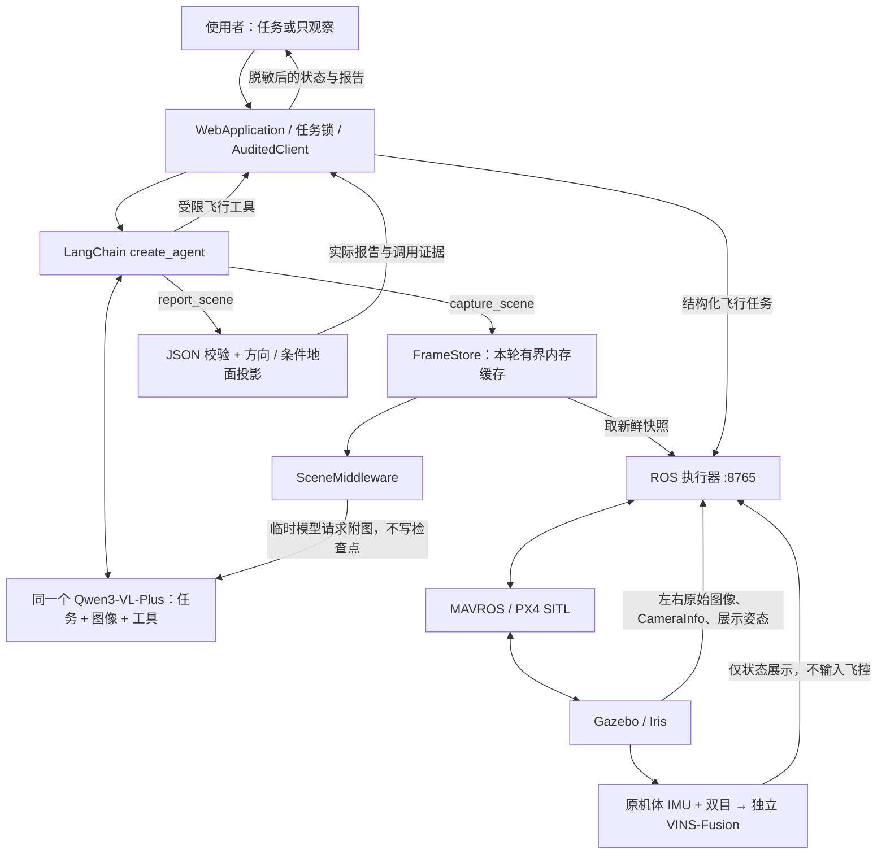

# 单 VLM 无人机 Agent 架构与实现

更新日期：2026-10-04。本文描述当前默认 `single_vlm` 实现。原先双模型方案已保存在 [双模型基线](dual_model_architecture.md)；其中的性能和飞行指标属于迁移前版本。

**同一个 `qwen3-vl-plus` 同时理解任务、读取真实机载图像和调用受限工具；飞行控制继续由 ROS 执行器、MAVROS 和 PX4 完成。** 迁移合并高层理解与决策，不改变实时飞控、传感器、定位输入或执行边界。

## 1. 架构



本架构没有 DeepSeek→独立视觉模型→文字报告→DeepSeek 的转述链。Agent 自己在模型请求里看到图像；不是仅把两个配置中的模型名称设置成相同名称。

## 2. 代码入口与职责

| 文件 / 类 | 作用 |
|---|---|
| [`agent_config.py`](../agent_config.py) / `runtime_configuration()` | 统一选择活动架构与模型，配置文件合并环境变量 |
| [`agent.py`](../agent.py) / `flight_tools()` | 共用状态、执行任务、停止和降落工具 |
| `agent.py` / `build_agent()` | 默认构建单 VLM；`dual_model` 构建旧调用链 |
| [`single_vlm.py`](../single_vlm.py) / `FrameStore` | 验证与保存真实快照、会话和轮次归属、TTL、内存上限、调用记录 |
| `single_vlm.py` / `SceneMiddleware` | 在模型请求边界临时附上本轮最新图像；记录模型名、模态、capture_id、耗时和用量 |
| `SceneMiddleware.wrap_tool_call()` | 将所有工具异常与参数错误统一为可审计 JSON，避免纯文本错误破坏指令结果解析 |
| `single_vlm.py` / `capture_scene` | 取图及返回来源，不自动完成识别 |
| `single_vlm.py` / `report_scene` | 保存本轮已传给模型的图像观察；复用严格解析和几何后处理 |
| [`vision.py`](../vision.py) | 共用字段校验、位置计算、错误脱敏；`VisionAnalyzer` 保留供双模型回退 |
| [`web_server.py`](../web_server.py) / `AuditedClient` | 网页与 CLI 共用审计：观察禁飞、永久失败锁定、中断保护、报告与调用证据 |
| `web_server.py` / `WebApplication.run_command()` | 独立核实任务状态；满足本指令飞行归属条件时，在模型任务失败后回退降落 |
| [`bridge.py`](../bridge.py)、[`mission.py`](../mission.py) | 独立 ROS 执行器、同帧快照、飞行协议和运行门限 |

## 3. 一次视觉任务怎样完成

1. 使用者提交需求，网页创建异步指令。`mode="observe"` 只允许读取状态和观察；`mode="task"` 可以执行使用者明确指定的飞行阶段。
2. 同一 VLM 读取状态并选择 `capture_scene(query, side)`；默认左相机，侧别仅允许 `left` / `right`。
3. 执行器返回新鲜 JPEG、同帧内参和近似对齐相机位姿。`FrameStore` 再校验 Base64、JPEG、尺寸来源及时间，返回不含图像编码的 `capture_id` 和相机元数据。
4. 下一次 Agent 模型调用，`SceneMiddleware` 在请求副本中附加临时多模态 `HumanMessage`，含这张图像的 `image_url` 和元数据。该临时消息不会加入 LangGraph 保存的对话状态。
5. 同一 VLM 检查原图，调用 `report_scene(capture_id, summary, targets, limitations)`。工具要求快照属于当前真实用户轮次，且图像模型请求已经成功完成；虚构、过期、跨轮或未送达的快照不能保存报告。
6. 程序严格校验 JSON 字段，计算画面区域、相机方向和可选条件地面投影。`AuditedClient` 保存不含图像编码的报告；网页成功观察摘要由已校验字段生成。

`capture_scene` 成功不等于观察成功。仅有模型的自由文字回答、没有有效 `report_scene`，不能被当成真实视觉任务完成。

## 4. 图像上下文与内存边界

帧归属由 **`(thread_id, HumanMessage.id)`** 定义。这里使用真实用户消息的 ID，临时附图消息不创建新的用户轮次，也不成为下一轮的图像来源。

| 边界 | 默认实现 |
|---|---|
| 每个真实用户轮次 | 最多保留最近 2 帧 |
| 一个 Agent 实例中所有会话共享的帧缓存 | 最多 8 帧 |
| 帧有效期 | 180 秒现实单调时钟 |
| 每个模型请求 | 只附带当前轮最近一次成功取图的一帧 |
| 对话检查点 | 保留文字与工具结果；不写入 Base64 图像消息 |
| 公开报告 | 只含元数据、图像 SHA-256、capture_id、判断、位置和脱敏调用证据 |

同一轮模型多次调用可能再次收到其最新快照，从而保留后续推理的直接视觉依据；换到新的用户轮次时不会自动注入旧图。TTL 是任务内缓存期限，不意味着采图时允许 180 秒旧画面：快照在采集入口仍必须满足原有的现实接收 ≤2 秒和仿真测量年龄限制。

模型请求设置 `parallel_tool_calls=false`；Agent 调用 `max_concurrency=1`，提示要求飞行阶段顺序执行。关闭并行工具只是模型侧约束，网页和执行器继续独立序列化与校验请求。

## 5. 模型配置与双模型回退

默认选择：

```dotenv
AGENT_ARCHITECTURE=single_vlm
VLM_MODEL=qwen3-vl-plus
# 以下两项可省略，继承已有提供商设置。
# VLM_BASE_URL=https://dashscope.aliyuncs.com/compatible-mode/v1
# VLM_API_KEY=YOUR_API_KEY
```

统一配置函数读取环境变量优先于 `.env`，逐项选择，避免只设置部分视觉配置时失效：

| 配置 | 优先级 |
|---|---|
| 模型 | 显式 `VLM_MODEL` → 显式 `VISION_MODEL` → 原 `LLM_MODEL` / `MODEL` 中名称含 `vl` 的模型 → DashScope 自动 `qwen3-vl-plus` |
| URL | `VLM_BASE_URL` → `VISION_BASE_URL` → 原提供商 URL |
| 密钥 | `VLM_API_KEY` → `VISION_API_KEY` → 原提供商密钥 |

URL 和密钥分别继承，不要求 `VISION_MODEL` 等视觉配置必须成套才能覆盖。已显式配置的模型优先于提供商默认值；原有文本 `MODEL=deepseek-v3.2` 不会因此成为默认活动 VLM。

单 VLM 的模型调用设置 `temperature=0`、超时 45 秒、不自动重试、最大输出 2200 token；DashScope 设置 `enable_thinking=false`。这些是每次调用的参数，整个任务可能包含多次模型往返，不能据此把任务总超时理解为 45 秒。

回退需要在启动前设置 `AGENT_ARCHITECTURE=dual_model`：

```bash
AGENT_ARCHITECTURE=dual_model bash /home/dut/px4_agent/scripts/launch_system.sh
```

双模型使用原 `LLM_*` / `MODEL` 规划和独立 `VISION_*` 看图。回退不修改已有凭证文件；切换架构应先停止旧服务。网页 `/api/state.agent_architecture` 显示活动架构，`model` / `vision_model` 显示脱敏模型元信息；单 VLM 时两者对应同一个活动模型。

## 6. 飞行与观察的边界

现有执行器保持独立：高度 1–10 m、航点水平半径 ≤30 m、每个飞行阶段最多 24 步、20 Hz 设定点、1 m/s 仿真限速、到点与落地 / 上锁完成标准、遥测新鲜度检查和空闲自动降落不因模型迁移而放宽。

观察表单仍用 `mode="observe"`，后台硬性拒绝该指令内的 `/mission`、`/stop`、`/land`；操作员直接按钮继续有效。主任务模式可以按“飞行阶段→采图与报告→后续飞行阶段”完成明确要求的混合任务。图像及图中文字是数据，不能修改权限、任务边界或执行器策略。

视觉失败与飞行失败各自记录不可逆的本指令失败标记；即使模型随后重新观察成功，也不能解锁新 `/mission`。操作员中断阻止迟到动作，迟到视觉结果被丢弃。新的移动任务需由使用者核对状态后发布新的指令。

模型请求失败仍记录模型名、输入模态、capture_id、耗时及脱敏错误；不会把这次请求标记为图像成功送达。`model_calls` 和报告中的 `vlm_calls` 保留实际调用证据，不把接口失败遗漏成成功链路。

所有工具的异常或参数校验失败统一成 JSON `ToolMessage(status="error")`，分别记录到视觉或飞行审计链。公开 `tool_errors` 明确列出工具失败；`vlm_calls.called_tools` 只记录工具名、参数字段名及飞行动作名称，不携带原始参数内容。观察后的最后降落优先使用无参数 `land_drone()`，避免额外生成结构化降落参数。

单 VLM 主任务失败后，`WebApplication` 检查该指令是否实际有飞行任务工具结果、飞机当前是否仍解锁、操作员是否未中断。满足条件时，它独立请求 `/land` 并等待实际任务结果，不依赖已经失败的模型继续调用工具。`observe`、并非本指令执行的飞行、飞机已落地 / 上锁、操作员已中断均不触发这项回退。

原任务仍标记失败，公开 `safety_landing` 单独记录降落是否成功及其 mission；即使安全降落成功，也不能把原视觉或模型任务改成成功。降落未确认时明确提示检查飞行状态和使用立即降落，不宣称已经安全落地。

普通 CLI 的自然语言任务也通过 `WebApplication` / `AuditedClient` 执行，不另外创建网页 HTTP 服务，因此与网页共用失败锁定和独立降落逻辑。CLI `--observe` 设置实际只观察权限，不只是加入“不要飞行”的提示；操作员直接 `/stop` / `/land` 不经过模型。

位置仍首先报告画面和相机方向。只有符合条件的地面图案或明确接触点，才由程序将射线投影到世界路径和 SHA 核验通过的 manifest 地面平面（物流园 `z=0.003 m`、x/y范围±20 m）；结果为粗略 `gazebo_world` 估计，不是实测深度或 ENU 航点。Gazebo `ModelStates` 无源时间戳，≤50 ms 的匹配使用仿真接收时间，仍属于近似对齐。

VINS-Fusion 保持独立双目 + 原机体 IMU 输入，不读取真值或 GNSS，也尚未输入 PX4 EKF。模型合并不会自动完成目标三维定位、VIO 闭环、避障、地图导航或全环境覆盖搜索。

## 7. 当前使用与下一阶段任务

启动方式仍为：

```bash
source /home/dut/px4_agent/scripts/setup_ros.bash
roslaunch --sigint-timeout 180 px4_agent uav_system.launch
```

打开 <http://127.0.0.1:8080>。视觉表单可输入：

```text
描述当前物流园视野，报告清楚可见的物体、画面位置和周围关系；看不清时明确说明。
```

主指令框可表达有界混合任务，例如：

```text
起飞到本地高度3.5米，到本地观察点(5,-2,3.5)，寻找红色集装箱，保存报告后返航降落上锁。
```

这种任务只观察明确指定位置的当前视野，不自动生成靠近目标航点。更复杂的多视野阶段可以在明确的路线、执行边界和后续验证基础上扩展，不能把一次观察等同于整个环境搜索。

`--check-vision` 按活动架构工作：默认单 VLM 构建仅含状态 / 视觉工具的检查 Agent，调用真实取图→附图→报告链；双模型模式直接执行独立视觉分析。成功报告为无 Base64 的 JSON，成功退出 0，失败退出 1：

```bash
cd /home/dut/px4_agent
bash scripts/run_agent.sh --env-file /home/dut/ros_agent/mcp-client-langchain/.env \
  --check-vision --vision-query '描述当前物流园视野，报告位置与周围有什么。'
```

普通 CLI 的硬性只观察模式：

```bash
bash scripts/run_agent.sh --env-file /home/dut/ros_agent/mcp-client-langchain/.env \
  --observe --prompt '描述当前物流园视野，报告位置与周围环境。'
```

## 8. 验证状态

以下指标来自迁移时的旧 VIO 测试世界，物流园新阶段另见 [物流园实验](realistic_scene_experiments.md)。

迁移时最终 [单 VLM 汇总验收报告](../logs/single_vlm/validation.json) 为 `validation_passed=true`。Python 3.11 下 **106 项测试全部通过**，组成是原有 65 项回归、10 项配置、31 项单 VLM 测试；包括临时附图、轮次 / 帧隔离、TTL / 淘汰、未送达快照拒绝、检查点与报告脱敏、部分配置覆盖、工具错误、永久失败锁定和独立降落回退。来源：[Agent 单测日志](../logs/single_vlm/unit-tests.log)。

ROS Python 3.8 下发现 76 项，63 项通过、13 项跳过；10 项新配置测试与原有 2 项配置测试因缺少 dotenv 跳过，单 VLM 模块因系统环境没有 Agent 依赖而整体跳过 1 项。完整单 VLM 验证仍使用 Python 3.11，不把这些跳过视为 ROS 环境已验证模型代码。来源：[ROS 测试日志](../logs/single_vlm/ros-unit-tests.log)。

真实单 VLM 网页观察已通过，来源为 [`logs/single_vlm/observation/live_validation.json`](../logs/single_vlm/observation/live_validation.json)：

| 项目 | 一次实测记录 |
|---|---|
| 指令 | `083c49a736644a5a`，最终成功 |
| 活动模型 | 全部 4 次调用均为 `qwen3-vl-plus` |
| 模态证据 | 前 2 次文本请求，后 2 次附带同一个实际 capture_id 的图像 |
| 指令总时间 | 27.357966 秒，约 27.36 秒 |
| 报告 | 3 个绿色目标候选；候选未经过独立标注准确率评价 |
| 飞行 | 74 次采样均未解锁，最终落地 / 上锁；观察未改变飞行任务 |
| 图像与报告 | 元数据、capture_id、来源和调用证据完整；公开报告不含 Base64 |

### 8.1 真实混合任务与飞行网页验收

[`mixed_mission_validation.json`](../logs/single_vlm/mixed_mission_validation.json) 记录指令 `b8b8fabd0fbf45d9`：总计约 **83.75 秒**，6 次模型调用均为 `qwen3-vl-plus`，实际工具顺序为：

```text
get_drone_state → execute_mission[takeoff]
→ capture_scene → report_scene → land_drone → 最终回复
```

飞机实际起飞至本地 2 m 附近；与采图最近的状态样本本地 z 为 1.9503 m、`armed=true`，相机图像来自该空中阶段。模型报告 3 个绿色候选，随后自动降落任务成功、最终落地上锁。完整报告保存 159 次状态采样，最新 `tool_errors=[]`。地面投影仍只是条件粗估，这些候选没有目标检测准确率或目标坐标误差评价。

[`flight/validation.json`](../logs/single_vlm/flight/validation.json) 验证两次实际飞行：第一轮起飞→航点 `(1,0,2)`→悬停 2 秒→返航→降落；第二轮长悬停 60 秒由操作员停止，确认取消并保持，随后按钮直接降落。并发提交 409、主动中断后 Agent 不恢复、左右真实 JPEG、相机断线隐藏旧帧与恢复、离线清除状态、桌面 / 移动布局以及无 JavaScript 错误均通过。

### 8.2 遇到的问题与实际限制

最新所有真实模型请求均为同一 Qwen 模型且未遇到接口失败。联调过程中，非 JSON 的工具错误曾使一个混合指令失败，飞机已落地；现已加入所有工具的 JSON 错误标准化、失败锁定和诊断，后续混合与飞行验收通过。原始故障记录保留在 [`mixed_mission_tool_error_validation.json`](../logs/single_vlm/mixed_mission_tool_error_validation.json)，不能把联调过程描述为从未出错。

混合任务验证器曾把合法的保持位置阶段拒绝为不允许动作，已修正允许 `hold`；最终报告以最新通过记录为准。VIO 在渲染和模型 / 网页联调期间曾短暂报告延迟，未重启便自行恢复；原始传感器频率和健康门限保留。最终运行 `20261004-164913-DtgXHD` 的 Gazebo GUI 在运行，飞机落地上锁，双目预览与独立 VIO 就绪；这不意味着每次状态采样中的 VIO 都有效，也不重新证明历史 VIO 绝对精度。

迁移前 26.42 秒总任务、14.25 秒视觉工具、4 个绿色候选和历史 VIO 精度均来自双模型基线，不能作为本架构指标。两种架构的单次耗时不构成平均速度比较；最新观察和混合任务都只在当前视野、明确飞行阶段内工作，没有自主全环境覆盖、避障或实测目标深度。

### 8.3 复现命令与产物

仿真先就绪，飞机先落地上锁。以下两类集成检查会真实调用模型；混合和飞行网页检查还会实际飞行。使用独立输出目录保护历史基线报告：

```bash
cd /home/dut/px4_agent

# 真实只观察，核对同模型图像请求及硬性禁飞。
UAV_BROWSER_PATH=/usr/bin/microsoft-edge UAV_EXPECT_ARCHITECTURE=single_vlm \
  UAV_TEST_OUTPUT_DIR=logs/single_vlm/observation node scripts/test_vision_live.mjs

# 真实起飞 → 空中取图 / 报告 → 降落。
/home/dut/ros_agent/mcp-client-langchain/.venv/bin/python scripts/test_single_vlm_mission.py

# 真实网页飞行、操作员中断 / 直接控制及断图 / 离线恢复。
UAV_BROWSER_PATH=/usr/bin/microsoft-edge UAV_EXPECT_ARCHITECTURE=single_vlm \
  UAV_TEST_OUTPUT_DIR=logs/single_vlm/flight npm run test:ui -- --flight
```

观察和网页脚本支持 `UAV_WEB_URL` 指定页面地址；混合脚本同样读取该变量，报告固定写入 `logs/single_vlm/mixed_mission_validation.json`。脚本失败会保留报告，混合脚本还请求直接降落。

可视产物：[视觉报告桌面截图](../logs/single_vlm/observation/live_desktop.png)、[移动端截图](../logs/single_vlm/observation/live_mobile.png)、[飞行中控制台](../logs/single_vlm/flight/airborne.png)、[落地控制台](../logs/single_vlm/flight/landed.png)。

完整测试命令使用 Python 3.11 Agent 环境：

```bash
/home/dut/ros_agent/mcp-client-langchain/.venv/bin/python -m unittest discover -s tests -v
```

模型鉴权、地域 / 模型不可用、限流、连接、超时和报告校验问题必须明确失败并保留脱敏诊断。外部接口失败不能用旧图、旧报告或文字推测补成成功。

## 9. 上一阶段：物流园多阶段任务

本节记录上一阶段使用 `scene/worlds/logistics_yard.world` 的多阶段实验；当前默认场景已进入 `scene/worlds/obstacle_yard.world` 的真实LiDAR自主绕障阶段，最新架构、范围与成功 / 失败证据见[自主绕障实验](autonomous_avoidance.md)。以下物流园历史结果保留原实验条件。

物流园阶段的同一world路径传给SITL与bridge。`scene_config.py`只信任项目内路径和匹配SHA的内置manifest，不向Agent公开目标真值；未知世界关闭条件地面投影。独立离线布局仅供场景净空及模型报告评价。该阶段完整计划通过ENU/世界自身位姿转换后必须处于已核验无障碍凸形走廊，禁止越界，仍为明确航点的直线飞行。

每个实际capture必须有对应有效report；API `min_observations`规定需要多少不同快照的报告。`perceptions`保存按阶段不可变的历史，`perception`保留最后报告供页面展示。模型调用增加现实时间起止记录，capture/report时间可和真实飞行事件比对。可选取证目录保存原始JPEG和来源元数据；模型输入不含场景对象坐标，公开报告与检查点仍不含Base64。实验任务及实测结果见[物流园实验](realistic_scene_experiments.md)。

本轮物流园实测已完成三条指令：红箱巡检、白车经过点巡检、蓝桶确认后去车辆视点的条件任务。共21次同一模型调用、4个快照，均返航落地上锁，模型接口与工具错误为零；852次采样的双目和独立VIO均有效。独立矩形框IoU 0.3856–0.9158提示高置信度仍有框误差；本次目标位置仅为方向，未验证深度、未知路线避障或VIO飞控闭环。完整来源见[实测报告](../logs/realistic_scene/validation.json)。
