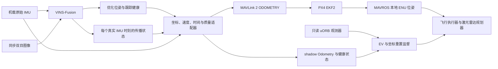

# VIO 融合与主动视觉搜索

最新进展（2026-10-09）：禁用 GPS 的断流、延迟与诊断后全新重置三类安全测试均已完成；每轮联合 37 项检查通过，完整 420 秒记录、17 项原参数恢复及所属进程关闭。见 [按顺序完成的安全阶段汇总](../logs/ev/no_gps_ev_height_reference_reset_continuation_01/sequence_result.json)。最初重置轮的地面采集竞态及原序列 **FAIL** 保留；修复只增加 clock/timing 实际订阅就绪屏障，评价和门限不变。新的 Qwen 实例地面验收和实际单模型配置通过；首个悬停任务已真实调用 DashScope `qwen3-vl-plus`：前两次文本请求成功，第三次仍是文本请求，在 45.086 秒后 `APITimeoutError`，无 HTTP 状态或 request ID。机载图像尚未采集或发送；[原始任务](../logs/ev/qwen_hgt3_lp4_stage_01/hover_task_01/final_task.json)及验收为 **FAIL**。自动安全降落已完成且上锁，没有重试、手写 ROI 或启动后续观察点/搜索；完整预定只读记录已完成 900.860 秒；17 项原参数已实际恢复且 19 个所属进程关闭，[本轮汇总](../logs/ev/qwen_hgt3_lp4_stage_01/sequence_result.json)保持 **FAIL**。调用链复核尚未确定网络或服务端原因。尚不能宣称本阶段图像识别或双目定位通过。

以下保留阶段性历史记录，当前完成与阻断情况以上述最新进展和 [实施结果](ordered_implementation_status.md) 为准。

本阶段按“观测验证 → 保留 GPS 的 EV 融合 → 禁用 GPS 的独立试验 → 双目米制定位与区域搜索”推进。飞行执行器继续负责实时设定点、激光雷达绕障和任务中断；语言模型负责理解任务、选择工具及解释实际图像。

当前状态（2026-10-09）：此前 GPS/EV 完整基线和三种故障试验已有通过记录；0.25 m/s 巡航候选的首轮 GPS 基线失败，原证据保留。随后服务端渲染线程预算的新完整 GPS 基线通过，17 项参数恢复且所属实例关闭；新的无 GPS 冷启动验收已完成，但重力轴误差超标，整轮 **FAIL**；17 项原参数已实际恢复，所属实例已关闭。已应用无 GPS 视觉高度参考候选（EKF2_HGT_REF=3，保留 BARO_CTRL=1）；34 项启动/参数/恢复测试通过，新实例已完成原五步任务、完整落地后 30 sim s 观测及 420.083 wall s 原始记录：原 20 项融合检查、5 项高度融合检查和新增 13 项高度精度检查均为 PASS。位置 RMSE 0.12763 m、最大重力方向误差 3.9566°；固定首次地面高度偏移后的空中/落地后最坏区间高度 RMSE 分别为 0.01349/0.01582 m。17 项原参数已实际恢复，所属实例全部关闭；[本轮整轮验收](../logs/ev/no_gps_ev_height_reference_sequence_01/sequence_result.json)已封存为 **PASS**，独立汇总保留全部原 20 项与新增 5+13 项门禁。此有限运行未再现此前高度和姿态失败，不证明其唯一原因已修复。首个全新无 GPS drop 实例已完成一次 3 wall s 数据中断：原任务保持失败，监督器独立降落子任务完成并上锁，runner 没有备用回收；原 9 项故障、附加 8 项触发前高度融合与原 10 项恢复检查均为 PASS。独立记录完成 420.087 wall s，17 项原参数恢复且 19 个所属进程关闭，[drop 联合验收](../logs/ev/no_gps_ev_height_reference_fault_sequence_01/drop_01/joint_case_result.json)已封存为 **PASS**（37 项检查），汇总读取格式的单次中断另行保存，未重飞或更改原始数据。第二个全新 delay 实例也已完成一次 3 wall s 延迟，原任务失败而监督器独立降落成功；420.094 wall s 原始记录完整，原 9 项、附加 8 项、原 10 项与全部运行/恢复证据组成的 [delay 联合验收](../logs/ev/no_gps_ev_height_reference_fault_sequence_01/delay_01/joint_case_result.json)为 **PASS**（37 项）。17 项原参数已恢复，19 个所属进程关闭。第三个 reset 实例在起飞前地面验收失败：首条 shadow 到达时记录器 /clock 尚为 0，且生产端 timing 订阅尚未就绪，唯一失败门禁为时间新鲜度。未起飞、未注入故障；17 项原参数恢复且 19 个所属进程关闭，[原三轮序列](../logs/ev/no_gps_ev_height_reference_fault_sequence_01/sequence_result.json)保持 **FAIL**。记录器现已在创建里程计订阅前等待真实正时钟及有效生产端 timing 回调，保留全部启动事件和原门限；两套 Python 各 45 项纯 mock 检查通过，独立源码复核确认评价函数和门限不变。已按 [新的诊断后续预登记](../logs/ev/no_gps_ev_height_reference_reset_continuation_01/predeclared_launch_01.json)启动独立新 reset 实例，前两轮通过结果只引用，未重飞。当前尚未实际调用 Qwen。此前 LiDAR 接收间隔和 VIO 接地姿态突变的根因尚未完全解释，单次通过不等于其原因已经修复。

[Gazebo 服务端渲染线程预算候选](../logs/ev/gazebo_server_thread_budget_design_01/root_applied_01.json)已应用：服务端 `LP_NUM_THREADS=4`，GUI 节点保持 2。八种离线 launch 解析、十项证据结构检查及两份逐字节源码复核通过；[单次实际完整 GPS 基线](../logs/ev/gps_fused_server_thread_budget_sequence_01/sequence_result.json)进一步核验了线程数和原有全部门禁。它仍不能证明此前 LiDAR 延迟或 VIO 姿态失败的唯一原因。

截至 2026-10-08，`shadow_flight_06`、V9 地面验收及[单次视觉生命周期诊断](../logs/ev/native_v9_visual_diagnostics_01/sequence_result.json)已有通过记录；V9 原五步融合任务 `256101a66755` 的接地视觉失效与整轮 **FAIL** 原证据保留。针对旧相机物理 link 相对机体的明显位姿变化，已实施[相机直接挂到 base_link 的刚性安装修复](../logs/ev/rigid_camera_mount_design_01/rigid_camera_mount_provenance.json)。新的[三次预登记冷启动](../logs/ev/rigid_camera_mount_sequence_01/cold_sequence_result.json)与[原五步 GPS/EV 飞行及落地后 30 sim s 完整质量验收](../logs/ev/rigid_camera_mount_sequence_01/flight_01/task_validation.json)均为 **PASS**，位置 RMSE 0.15909 m、最大姿态轴误差 4.6629°、落地窗口最大漂移 3.034 mm。但在该质量窗口结束后，[实际 PX4 pid556151 因 SIGABRT（exit -6）退出](../logs/system/20261008-165436-9v2BTw/sitl.log)，manager 自动关机；[原始 uORB 记录](../logs/ev/rigid_camera_mount_sequence_01/uorb_flight_01/summary.json)仅完成预定 360 wall s 中的 193.150 s，因进程身份丢失而 **FAIL**。因此该旧轮的整轮运行门禁为 **FAIL**，不能把其质量 PASS 当作完整基线通过。该轮[原始 FCU 融合独立复核](../logs/ev/rigid_camera_mount_sequence_01/flight_01/independent_review_01/flight_quality_and_runtime_failure_proof.json)已完成：空中实际 EV 位置、速度同时接受融合 **109/109**，落地窗口 **121/121**；这些异步采样不证明每个数据包或连续时刻均融合。原 allocator/SIGABRT 根因仍待排查。该旧 [GPS drop 独立 manager 的启动结果](../logs/ev/gps_fused_cli_cleanup_fault_sequence_01/sequence_result.json)因 Gazebo server/client 实际 SIGSEGV **FAIL**，原记录保留。后续真实 GUI 基线和 GPS/EV 故障阶段已通过；当前进展见下文最新记录。

后续[单次 GDB 普通地面观测 03](../logs/ev/px4_heap_abort_diagnostic_03/observation_result.json)取得 360.352546 wall s 记录，recorder 无错误，未出现 SIGABRT 或取得 core；结果为 **NOT_REPRODUCED**，不代表异常退出已经修复，也不是飞行验收 PASS。显式参数恢复已在该新 manager 实际核验通过，固定 17 项原参数由 54 条实际命令恢复并读回，详细记录见下文。

[第一版 listener 单次快照及 daemon 输出流清理生产构建](../logs/ev/px4_cli_cleanup_build_01/provenance.json)已通过，但[普通启动 sequence01](../logs/ev/px4_cli_cleanup_sequence_01/sequence_result.json)在地面质量、profile 应用及解锁之前即因 `terminate called without an active exception` 和 SIGABRT **FAIL**。随后[真实 GDB stack/core](../logs/ev/px4_cli_terminate_diagnostic_01/result.json)直接定位到新 daemon 实现对正常退出 worker 的无条件 cancellation 穿过 `LockstepScheduler::TimedWait` TLS 析构中的 `usleep`，触发 `std::terminate`；server 同时正在 join 该 worker。这证明的是新候选的正常 TLS cancellation 回归，不能据此归因原来的 `double free or corruption (out)`。

[第二版完成状态修正](../logs/ev/px4_server_cleanup_design_02/manifest.json)已完成独立源码复核、普通返回/断连/TLS/pending-cancel 正向检查及 native-header 编译；正常完成 worker 仅 join，统一 cleanup 在 TLS 析构前禁用 cancellation，FILE 仍只在成功 join 后关闭。该版已应用到生产源码，[第二次完整 PX4 构建](../logs/ev/px4_cli_cleanup_build_02/provenance.json)也已通过并冻结（binary SHA256 前缀 `9877df9e`）。新预登记 [sequence02 的实际整轮结果](../logs/ev/px4_cli_cleanup_sequence_02/sequence_result.json)已为 **PASS**：同一次全新 GPS/EV 启动完成地面 30 sim s、原五步飞行、完整 post30 质量、360.100310 wall s 原始记录及记录后真实所属 PX4 存活核验。独立选中实例 EV 位置、速度融合为空中 **140/140**、落地窗口 **128/128**；这些异步采样不证明每包或所有连续时刻均融合，有限运行 PASS 也不证明原 heap-abort 根因或全场景稳定。旧 runtime FAIL 与 sequence01 启动 FAIL 原证据保留。

Gazebo 启动故障的[两份实际 core 审阅](../logs/ev/gps_fused_cli_cleanup_fault_sequence_01/gazebo_startup_crash_01/independent_review_01/REVIEW.md)已确认：程序及 OGRE 插件 BuildID 匹配，`refreshConfig()` 在空 `mVideoModes` 上读取首项导致 SIGSEGV。崩溃后的[正常 XRandR 查询](../logs/ev/gps_fused_cli_cleanup_fault_sequence_01/gazebo_startup_crash_01/display_mode_probe_01/actual_display_result.json)记录父 DISPLAY `:1` 的模式数为 0；这是后续采样，不能当作崩溃时 XRandR 局部变量的实测值。该显示故障发生在场景加载前，未归因到 PX4、VINS 或相机模型。

独立 Xephyr 显示原型已取得[有效显示模式](../logs/ev/gps_fused_cli_cleanup_fault_sequence_01/gazebo_startup_crash_01/display_mode_probe_01/nested_visible_01/result.json)、[所属父窗口真实映射](../logs/ev/gps_fused_cli_cleanup_fault_sequence_01/gazebo_startup_crash_01/display_mode_probe_01/nested_visible_01/actual_owned_window_map.json)和[正常 GLX 上下文及绘制](../logs/ev/gps_fused_cli_cleanup_fault_sequence_01/gazebo_startup_crash_01/display_mode_probe_01/nested_visible_01/glx_positive_01/actual_glx_result.json)证据；实际 renderer 为 Mesa `llvmpipe`。统一显示入口仍在实现，这些能力检查尚不证明新的 Gazebo 画面或飞行验收通过。接入后按[新的预登记完整基线](../logs/ev/visible_gazebo_display_baseline_01/predeclared_plan.json)重新执行 ground30、原五步、post30 和 360 wall s 记录，保持相机分辨率、标定、VINS 及飞行质量门限。

另一个[执行器尚未启动时的退出等待修复](../logs/ev/pre_bridge_cleanup_design_01/production_apply.json)已应用并通过独立源码审阅与隔离检查：仅在从未记录 bridge PID 时跳过不存在的落地端点等待，已经启动后 bridge 退出仍保留原等待保护。此次失败实例还通过真实 `commander status` 的 `not running`、未发布飞行状态话题和[所属进程清理](../logs/ev/gps_fused_cli_cleanup_fault_sequence_01/gazebo_startup_crash_01/owned_pre_bridge_shutdown.json)证据完成关闭；没有据此证明 no-GPS 启动早期的参数恢复。

## 定位链路



VINS 的 `odometry` 和 `imu_propagate` 线速度实际位于其独立 world 坐标系。适配器显式旋转到机体 FLU，补偿 IMU 相对 base_link 的 2 cm 杆臂，再生成合法 ROS Odometry。它只使用 VINS、原始机载 IMU 和 VINS 的陀螺偏置；Gazebo 与 GNSS 不参与此估计或重锚。

传播输出保留真实 IMU 测量时间，不用定时器重发旧姿态并改时间。当前源传播频率为 250 sim Hz，发送频率为 50 sim Hz。协方差来自明确的保守配置及传播时间增长，**不是 VINS 原生估计协方差**。`quality=1` 仅表示通过二值健康门，不代表概率。

真实 raw MAVLink 入口为 `/mavlink/to`。LOCAL_FRD 表示初始航向任意的局部坐标，BODY_FRD 表示机体速度；转换同时处理位置、姿态、速度及协方差。MAVLink 2 保留 `reset_counter`、`quality`、CRC 和序号。VINS 重启、时钟回退或异常跳变会锁存新 epoch，停止旧坐标流；恢复要求地面上锁且明确重锚。

## 飞控模式与证据

| profile | EV_CTRL | GPS_CTRL | 高度参考 | 作用 |
|---|---:|---:|---|---|
| shadow | 0 | 7 | 气压计 | 验证独立 VIO，不向 FCU 发 EV |
| gps_fused | 5 | 7 | 气压计 | EV 水平位置及三维速度与 GPS 并用 |
| no_gps | 7 | 0 | 视觉 | EV 三维位置与速度作为参考；保留气压计备用和磁力计，完整单次基线已通过，故障验收进行中 |

`no_gps` 不是所有传感器只剩视觉的模式。其独占启动 hook 在官方 `px4-rc.params` 时点、EKF 启动之前禁用 GPS 融合，并保留原始参数、目标参数、hook 哈希和执行标记。不会用先依赖 GPS 建立定位再关闭融合来冒充无 GPS 冷启动。该无 GPS 启动 hook 本身不修改 PX4 源码。

无 GPS 配置还将 `COM_OBL_RC_ACT` 设为 4（Land）、`COM_OF_LOSS_T` 设为 1 sim s，按实际读回值记录并在退出时恢复；shadow 与 gps_fused 保留启动时观察到的原值。当前 PX4 v1.14 的 AUTO_LAND 需要有效水平位置，而内部 DESCEND 只要求高度、姿态和角速度有效。Offboard 水平位置失效即使仍收到设定点也可能触发 offboard loss，Land 动作会依据实际传感器有效性降级。DESCEND 没有水平位置控制，不能当作受控 XY 降落；若高度、姿态或角速度也失效，仍可能进一步进入终止。参数和源码只说明策略，完整安全性须由真实故障试验确认。

仅“参数已设置”“FCU 已收到 EV”不能证明融合。`record_ev_fusion.py` 和运行中的 `ekf_monitor.py` 检查实际选中的 EKF、EV 控制标志、aid-source 的创新拒绝状态及持续推进的 `time_last_fuse`。网页中的 `used_for_flight_control` 据此生成。

EV 断流、延迟、VINS epoch 或 PX4 本地坐标重置会阻止新的移动并触发独立降落。旧任务与安全降落分别保留结果。AUTO.LAND 仍依赖有效本地定位；持续失联后的安全性必须由实际故障试验确认。禁止绕过解锁检查。

PX4 的 `nav_state=18`（位置降落）与 `nav_state=12`（无水平控制的 DESCEND）都会编码为 MAVROS 的 `AUTO.LAND` 字符串，因此不能仅凭这个字符串区分两者。只读观测器新增实际 `vehicle_status` 和 `failsafe_flags`；故障验收要求同一轮真实 uORB 记录中的 nav state、发布时间、高度/姿态/角速度有效性，并分别报告两种状态。缺证据、陈旧数据和终止状态不能作为自动降落模式证明。

纯降落请求仍经过任务格式、提交锁和任务所有权校验，但其执行与完成只依赖 3 wall s 内实际 FCU heartbeat/ExtendedState，不要求已经失效的水平位姿、视觉或世界坐标配准。其他任务仍保留原定位与场景门禁。AUTO.LAND 服务 ACK 不能当作切换成功，只有真实 heartbeat 确认后才关闭设定点流；完成还须新鲜的落地与上锁状态。系统在实际 PX4 stream 上将 heartbeat 和 ExtendedState 源频率设为 5 Hz，以适应 0.35 倍仿真速度，不在 ROS 端重发旧状态。纯降落 70 项定向回归见 [验证记录](../logs/ev/autopilot_landing_contract_01/validation.json)，仍不代替实际故障飞行。

模型任务的回收按本次命令审计的任务 ID 处理：网页后台对仍运行但尚未解锁的所属起飞任务，也会以 expected mission ID 取消并降落；已经运行的纯降落只等待。搜索/正向视觉验收 runner 同时校验命令与任务归属，最多等待 180 wall s，完成还要求当前实际 FCU heartbeat/ExtendedState 新鲜。见 [网页回归](../logs/ev/web_prearm_recovery_contract_01/validation.json) 和 [runner 回归](../logs/ev/stage4_runner_recovery_contract_01/validation.json)，没有据此宣称实际故障飞行已通过。

GPS 融合试飞 01 暴露了位置重置与姿态重置需要区分的问题。PX4 在离地约 1.5 m 后进行磁航向重对齐：`resetQuatStateYaw()` 更新姿态及其输出历史，不旋转 EKF 位置和速度状态。本次实际 `heading_reset_counter=1→2`、`delta_heading=0.01735 rad`，同时 `mag_aligned_in_flight=False→True`，xy/z 与速度重置计数、选中实例均未变化。但是航向会改变 LiDAR 投影及 LOCAL_FRD 外部视觉测量的转换，不能普遍忽略它。

新代码只允许正在执行起飞、水平导航尚未开始时，一次有完整真实证据的磁对齐：航向增量不超过 3°、计数模 256 恰好加一、位置/速度计数与实例/VIO epoch 保持稳定，原 EV 位置及速度融合健康。磁标志转换和重置观测的源时间必须匹配在 0.5 sim s 内；分别保存 PX4 采样时间、发布时间和 monotonic 等待期限，不使用接收时间替代采样时间。磁标志正常约 1 sim Hz 发布、变化时立即发布，因此一般标志新鲜度与转换匹配窗口分别检查。

接受后仍保留独立 `alignment_pending`，最多等待 10 s 墙钟；只有真实新本地样本、不早于重置观测的源时间、`heading_good_for_control=True`、磁对齐与原融合健康同时满足，才解除。执行器更新 ENU 航向时使用 NED 增量的负号，清除旧姿态历史并设置源时间屏障，在 3.5 m 建立至少五次有效新扫描的地图后再允许水平移动。xy/z、速度、实例或 VIO epoch 的变化及缺失、超时仍中止；搜索的 coordinate epoch 继续包含 heading，旧目标观察不跨重置复用。guard/monitor 的 26 项纯测试已通过；后述刚性相机轮已有一次实际起飞磁对齐证据及五步质量 PASS，但**不改变 GPS 融合试飞 01 的 FAIL**，也不证明任意重置均可接受。

## 启动与验证

```bash
source scripts/setup_ros.bash
roslaunch --sigint-timeout=180 px4_agent uav_system.launch \
  gui:=true sim_speed_factor:=0.35 ev_profile:=shadow
```

通过对应前序验收后，将 `ev_profile` 改为 `gps_fused` 或 `no_gps`。退出入口先确认落地上锁，再恢复本次原参数并关闭拥有的子进程。注入测试只在明确启用 `ev_test_faults:=true` 的本机仿真中使用。

异常退出造成正常参数恢复未完成时，[启动入口](../scripts/start_system.sh)支持显式 `--recover-profile-from FILE`，仅接受已停止且身份匹配的旧 `ev-profile/original.json`。新所属 manager/PX4 在实际 Gazebo 地面上锁、FCU heartbeat/ExtendedState 新鲜后，先恢复固定 17 项参数并读回，再应用当前 profile；本次 `original.json` 因而记录恢复后的基线。源遥测先设置为真实 5 Hz，3 wall s 新鲜度门限、arming 检查和现有 profile 目标均不改变。[两套 Python 各 21 项契约测试](../logs/ev/profile_recovery_contract_01/validation.json)通过；[实际 manager `20261008-172447-PwEZ5H` 的恢复记录](../logs/system/20261008-172447-PwEZ5H/profile-recovery/result.json)也为 PASS，[54 条命令](../logs/system/20261008-172447-PwEZ5H/profile-recovery/commands.jsonl)由 51 次 show 与 3 次 set 构成，17 项实际值与旧基线完全一致，[新 profile 原档](../logs/system/20261008-172447-PwEZ5H/ev-profile/original.json)正确保存该基线，旧原档字节不变（SHA256 前缀 `401a5dd2`）。当前入口明确拒绝与 `no_gps` 直接同用：“先以 shadow/gps_fused 地面恢复并退出，再独立 no_gps 冷启动”，避免恢复旧 GPS 值破坏 pre-EKF 无 GPS 冷启动口径。

```bash
/usr/bin/python3 scripts/test_ev_shadow.py --fly \
  --output logs/ev/NEW_SHADOW_RUN --ground-duration-sim 30 --timeout 600
/usr/bin/python3 scripts/record_ev_fusion.py --record \
  --output logs/ev/NEW_EKF_RUN --duration 180
/usr/bin/python3 scripts/test_ev_faults.py --kind drop --execute \
  --output logs/ev/NEW_FAULT_RUN --timeout 300
```

质量验收固定门限：RMSE ≤0.25 m，最大误差 ≤0.6 m，落地后 30 sim s 的漂移 ≤0.15 m；真实输出至少 30 sim Hz，测量时间不得人为刷新。独立评价仅初始一次 yaw 与平移对齐，禁止尺度拟合及事后轨迹重对齐。Gazebo ModelStates 没有源时间戳，因此报告明确记录其接收时间匹配限制。

新的 `shadow_quality_gravity_axis_v2` 独立实验评价还要求对齐后机体 Z 轴的最大方向误差不超过 6°。这项工程门限用于识别地面位置很稳但姿态错误的情况；它保留固定初始 yaw，因此倾斜飞行时航向误差也可能影响结果，不宣称完全消除航向影响。缺失、非有限或非单位四元数拒绝通过。飞行 runner 在任何 OFFBOARD 准备、解锁前检查及任务提交之前，用同一评价函数检查最初 2 sim s；新门限不重写旧记录，也不向估计器反馈真值。见 [评价契约测试](../logs/ev/shadow_gravity_gate_contract_01/validation.json)。

原生 VINS 的实验静止约束只接收原始 IMU 和连续近景双目特征，不接收 Gazebo、GPS 或落地状态。每帧静止证据与每段连续静止区间分别保存；滑窗删除中间运动帧时不能产生跨运动的零相对位移约束。优化、残差/Jacobian、边缘化先验及优化与传播轨迹的一致性检查失败时，先报告跟踪失败，再重置，不冻结或夹紧输出。细节见 [原生实验说明](../vio/patches/STATIONARY_HEALTH.md)。

V4 对长静止期增加真实时间的关键帧条件：当下一次 `SECOND_NEW` 将使 IMU 合并跨度达到 1 s 时，改用标准 `OLD` 边缘化，保留全部原始 IMU 步骤。上游会跳过超过 10 s 的 IMU 因子；新条件避免其打断初始偏置先验的直接传递路径，不重复添加零偏置先验，也不固定绝对姿态。默认上游配置仍关闭，生成的 SITL 配置开启。健康记录分别保存本轮优化前的积分区间、实际使用/跳过的连接，以及滑窗后带源时间的姿态和偏置；拓扑连接不等于完整非线性可观测性证明。

GPS 融合试飞 01 的独立诊断还发现启动优化后的 tilt/Ba 耦合，以及大量求解未收敛或超过原预算；这不是已证实的唯一失效原因。SITL 配置与生成模板采用 `max_solver_time=0.12` 墙钟秒、`max_num_iterations=12`，OLD 仍使用上游 80% 预算，即 0.096 秒。配置等价性及九项原生/噪声回归已通过，源码与二进制未因这一预算实验改变。新实际地面试验改善了收敛率，仍存在约 11° 的重力方向误差与偏置补偿，**预算增加没有解决姿态问题，未进行本轮起飞**。配置与诊断证据见 [预算实验记录](../logs/ev/gps_fused_flight_01/native_initialization_analysis_01/budget_experiment_config_provenance.json)、[启动诊断](../logs/ev/gps_fused_flight_01/native_initialization_analysis_01/analysis.md) 和 [新地面记录](../logs/ev/native_budget_ground_01/summary.json)。

V5 保留了实际 Ceres 因子、局部 Jacobian、残差、固定参数和 OLD 边缘化前后矩阵，并修复了上游 `new[]/delete` 释放不匹配。旧库的 ASAN 实验复现错误，修复库完成 100 次相同循环；尚无证据将该内存错误与姿态偏差联系起来。矩阵记录默认关闭，仅通过 `PX4_AGENT_VINS_BIAS_DIAGNOSTICS_DIR` 对独占诊断目录开启。

新的 V5 冷启动地面诊断没有复现 11° 异常，独立重力方向误差最大约 2.95°。选定完整优化问题及前两次 OLD 的偏置有效信息保持六维；第三次 OLD 的均值比较对规范自由度与数值截断敏感，因此不能宣称初始偏置先验已丢失。真实第二次 OLD 求解后，全局 yaw 恢复量为 -16.164°，IMU 和视觉目标值保持不变，冻结的边缘化先验目标值却增加 2.420。独立有限差分还发现冻结先验使用的旋转 Jacobian 与当前四元数残差导数不一致。这是需要处理的具体优化一致性问题，**尚未证明它导致此前的 11° 倾斜**。见 [实际地面分析](../logs/ev/bias_information_runtime_01/full_problem_analysis_01/analysis.md)、[航向恢复证据](../logs/ev/bias_information_runtime_01/native_independent_analysis_01/gauge_rotation_proof_01.json) 和 [残差导数审计](../logs/ev/bias_information_runtime_01/native_independent_analysis_01/additional_gauge_analysis_01.json)。

该轮大矩阵同步写盘明显影响实时性：290 条 EV 状态中有 226 条因优化测量过期未就绪，仅最后约 3.17 sim s 有接近 50 Hz 的输出。它只用于诊断，不计为吞吐量、位置质量或飞行验收通过。矩阵覆盖初始 5.552 sim s，但完整原始 ROS 采集较晚开始，不能冒充完整启动 IMU 回放。后续普通验收须关闭矩阵记录并重新运行。

V6 实验只修正已有边缘化残差对当前姿态扰动的导数：右乘局部旋转下，以相对四元数的同半球符号乘 `w I + skew(v)`，链式作用于冻结的旋转 Jacobian。残差、初始线性化点、冻结信息矩阵和一次偏置先验不变；每个先验保存不可变开关，上游默认关闭，SITL 实验开启。它不增加姿态锚点，也不消除冻结先验自身的有限航向规范依赖，因此不能仅凭数值测试宣称倾斜已修复。实际矩阵回归中的旧目标梯度 +13.199 与有限差分 -71.551 方向相反，修正后与有限差分一致。每帧健康数据记录实际加载与当前先验模式；诊断模式另分开保存当前因子 Jacobian 和冻结的原矩阵。

关闭矩阵记录后的三次独立冷启动地面验收已[预先登记](../logs/ev/native_v6_cold_sequence_01/predeclared_plan.json)：每次 30 sim s，保持 GUI 与 0.35 倍仿真速度，全部通过新旧质量门禁后才进入完整融合飞行。任一失败即结束这组实验并保留证据，不通过反复换随机启动挑选成功结果。

V7 将首姿态的 XYZ 与 yaw 作为优化坐标基准，仅优化其横滚与俯仰，后续姿态仍为六自由度。横滚与俯仰采用固定 0.001 rad/单位坐标尺度，实际 Plus、Jacobian 和诊断映射保持一致；真实 IMU/双目全图回归检查错误倾角的修正，以及后续位置、航向和姿态的可观测变化。它不夹紧姿态，也不新增绝对横滚/俯仰测量；冻结先验已有的有限规范依赖使这项改变可能影响近似优化结果，仍不能仅凭数值测试宣称实际倾斜已修复。新的[三次冷启动计划](../logs/ev/native_v7_cold_sequence_01/predeclared_plan.json)保持所有质量门限不变、关闭矩阵记录，首次失败即停止；V6 失败单独保留。首轮实际冷启动已因 `Plus(x,-gradient)` 超出 Euler chart 而失败，说明固定毫弧度尺度不能保证 Ceres 梯度探测有效；离线运动测试的原始 IMU 初猜通过也没有覆盖真实初始化。

V8 候选针对 V7 真实大梯度探测故障，采用平滑且保持现有姿态 chart 的更新函数。零扰动处仍保持 `sB` 局部导数与 0.001 rad/单位尺度，冻结先验及原始测量不变；有限大步的行为与梯度停止度量会改变，不能凭梯度范数变小宣称物理误差收敛。新的[预登记验收](../logs/ev/native_v8_cold_sequence_01/predeclared_plan.json)除原三次地面质量门禁外，还要求整个原生启动日志没有不可用优化、梯度探测失败或失败重置，覆盖采集器订阅前阶段。实际因子、原失败运动初猜和构建测试通过后，V8 首次普通冷启动已取得完整 30 sim s 窗口：全启动日志无不可用优化、梯度探测失败或失败重置，实际 EV 位置、速度持续融合。但机体方向最大误差 12.236°，仍超过 6°，整轮失败。位置 RMSE 0.001058 m、最大误差 0.002177 m，通过位置和时序门禁不能批准飞行。第二、三轮及飞行未执行，已有失败不覆盖。

V9 将首次非线性初始化延迟到整窗原始 IMU 和近景双目都确认静止，初始化阶段的等待继续以 OLD 连贯维护真实滑窗。窗口平均重力方向、陀螺均值和零速度只生成一次传感器支持的初猜；横滚、俯仰继续自由求解，初始零偏置先验仍只通过标准边缘化传递。轻量原生健康记录从 INITIAL 等待开始，直接记录首次求解前的无先验状态，再记录同时间戳完成求解后的有效先验；大矩阵关闭。实际 Estimator、因子、噪声及迁移共 15 项定向测试通过，源码与构建已冻结并完成两份独立复核，见[最终版本记录](../logs/ev/native_v9_initialization_design_01/native_v9_provenance.json)。[预登记计划](../logs/ev/native_v9_cold_sequence_01/predeclared_plan.json)要求的三次全新启动均已通过，见[三轮结果](../logs/ev/native_v9_cold_sequence_01/sequence_result.json)及各轮独立复核。最大姿态轴误差 3.323° / 4.086° / 2.444°，位置 RMSE 0.001519 / 0.001171 / 0.002078 m，输出均为 50 sim Hz；完整 startup、初始化 source trace、真实选中 EKF 融合和配置版本均通过各自检查。

随后同第三轮启动执行[五步 GPS/EV 融合飞行](../logs/ev/gps_fused_v9_flight_sequence_01/flight_01/task_validation.json)。原任务完成 takeoff、两次 goto、return_home、land，真实上锁落地；起飞阶段 0.02093 rad（约 1.20°）磁航向重对齐有真实 uORB 窗口证据，导航图在重新取得扫描后建立。独立原始 uORB 复核得到 141 个空中采样周期：实际 EV 位置接受融合 141/141，位置与速度同时接受 140/141，一次速度创新被拒绝；选中实例保持0，GPS仍保留。具体时间、创新和异步采样边界见[独立审阅](../logs/ev/gps_fused_v9_flight_sequence_01/flight_01/independent_review_01/REVIEW.md)。重置前已记录的 shadow 数据位置 RMSE 0.128684 m、最大误差 0.237242 m、最大姿态轴误差 4.299°，均通过原门限。但 native source125.552 的有效优化特征持续不足触发 failure，ROS125.624报告 features=0，随后 epoch0→1，EV停止。独立 ModelStates 显示此时机体已接地静止，FCU仍armed/landing；原 land 完成晚约6.33 wall s。未取得落地后30 sim s连续shadow与漂移证据，整轮[结果为 FAIL](../logs/ev/gps_fused_v9_flight_sequence_01/sequence_result.json)。原始双目特征仍有64条，不能把原始数量当作成熟且未被剔除的优化特征；需进一步检查窗口内生命周期和剔除机制。无 GPS与模型视觉阶段未启动。

[预登记的针对性诊断](../logs/ev/native_v9_visual_diagnostics_01/predeclared_plan.json)已经完成，物理 V9、全部因子、特征剔除规则和 1.5 sim s 视觉失效门限保持不变，仅显式开启默认关闭的生命周期日志。[地面验收](../logs/ev/native_v9_visual_diagnostics_01/ground_01/task_validation.json)通过；原五步任务 `3afef5f844a7` succeeded，落地后 118.884–148.884 sim s 连续质量通过，shadow 位置 RMSE **0.080297 m**、最大误差 **0.128002 m**、最大姿态轴误差 **4.499°**、落地窗口最大漂移 **3.964 mm**，epoch 始终 0，无跟踪失败或锁存。独立 uORB 审阅的空中 EV 位置、速度接受融合均为 **150/150**，选中实例 0，GPS 保留；这些是异步实际观测，不证明每个数据包或所有连续时刻都融合。完整结果与边界见[独立审阅](../logs/ev/native_v9_visual_diagnostics_01/flight_01/independent_review_01/REVIEW.md)。

诊断仍记录到接地附近的短时轨迹耗尽：native source116.804 的成熟轨迹从求解前/后 **87** 条降至剔除后 **7** 条，实际删除 80 个 ID；相关重投影行及删除 ID 均未截断。随后已记录的缺口最大为 0.4 sim s，在 117.304 恢复到 10 条并清除计时，早于原 1.5 sim s 超时；之后还出现新的短缺口。它证明本次恢复及时，不能证明此前失效机制消失，也不覆盖原 `256101a66755` 的 FAIL。

原始 rosbag 正常关闭，保存双目、机载 IMU、Gazebo LinkStates/ModelStates 等原消息；110–120 sim s 的[离线安装分析](../logs/ev/native_v9_visual_diagnostics_01/mount_analysis_touchdown_01/summary.json)取得 **200** 对精确整数 header ns 配对、**40** 对原始字节和无损 PNG，无解析错误或未配对图像。同一 LinkStates 消息中，camera-link 相对 base_link 与该次固定 SDF 的最大偏差为 **15.112 mm / 2.6526°**（接收时间 115.652 sim s）；IMU-link 最大偏差仅 **0.0815 mm / 0.0118°**。该次 SDF 和标定按字节归档，相机 link 原点 [0.12,0.06,0.18] 与双目中心的 [0,-0.06,0] 局部偏移分开计算。LinkStates/ModelStates 无 source header，这些实际相对位姿和接收时间 bracket 不能证明图像渲染时刻的精确姿态，更不能独立证明旧 FAIL 的唯一原因；真值始终只用于评价，不反馈估计器或 Agent。

[刚性安装修复及源码来源](../logs/ev/rigid_camera_mount_design_01/rigid_camera_mount_provenance.json)将 multicamera sensor 直接放在 base_link 下，将 housing 并入 base，按平行轴公式合并原相机载荷惯性，移除独立相机物理 link/joint，保持光学标定和 native 算法。随后[三次预登记冷启动](../logs/ev/rigid_camera_mount_sequence_01/cold_sequence_result.json)全部通过，最大姿态轴误差分别为 2.7477°、2.7570°、2.7090°。原五步任务 `527efef4729f` succeeded，真实落地上锁；[飞行正式报告](../logs/ev/rigid_camera_mount_sequence_01/flight_01/task_validation.json)的完整质量为 **PASS**，shadow 位置 RMSE **0.159093 m**、最大误差 **0.227585 m**、最大姿态轴误差 **4.6629°**，94.752–124.752 sim s 落地窗口最大漂移 **3.034 mm**。该轮[原始 FCU 融合独立复核](../logs/ev/rigid_camera_mount_sequence_01/flight_01/independent_review_01/flight_quality_and_runtime_failure_proof.json)已完成：选中 instance 0，空中 **109/109** 个 armed-and-in-air 周期、落地窗口 **121/121** 个周期均证明 EV 位置、速度同时接受融合，GPS 保留。空中 source 范围为 65.716–92.452 sim s，落地窗口为 94.752–124.752 sim s；这些异步采样不证明每个数据包或所有连续时刻都融合。该独立证据仍不能覆盖旧 FAIL 或后述 runtime FAIL。[离线工具](../scripts/analyze_vio_mount_bag.py)兼容两种结构：新结构没有 camera LinkState 时明确 `unavailable_by_direct_parent`，不会捏造相机测量误差为零；由机体位姿和配置推导的相机世界位姿仅标记为 configured kinematics，实际 IMU 相对位姿继续测量。机械结构变化和新的质量结果仍不证明图像渲染时刻的精确姿态。

上述五步任务和质量窗口结束后，PX4 pid556151 异常退出，原始日志记录 exit -6（SIGABRT），manager 随即关闭该次系统。预先启动的 360 wall s uORB 记录仅取得 **193.150 wall s**，以无法唯一验证所属 PX4 进程的错误结束；见[运行日志](../logs/system/20261008-165436-9v2BTw/sitl.log)与[记录摘要](../logs/ev/rigid_camera_mount_sequence_01/uorb_flight_01/summary.json)。已有飞行和 post30 质量 PASS 保留在其观测范围内，**该旧轮的整轮运行门禁为 FAIL**；原 allocator/SIGABRT 根因尚未确定，其已通过的质量窗口不能单独批准后续故障、无 GPS 或模型任务。

异常退出后的 GDB 地面诊断按独立编号保留。[01](../logs/ev/px4_heap_abort_diagnostic_01/result.json)在正常内部实时信号 SIG32 上停住后退出，[02](../logs/ev/px4_heap_abort_diagnostic_02/result.json)在正常 SIGCONT 上停住后退出；两项诊断启动均为 **FAIL**，尚未开始参数恢复或飞行，不能当作原 heap abort 的复现。[03](../logs/ev/px4_heap_abort_diagnostic_03/observation_result.json)通过实际旧参数恢复后完成预定 360 wall s 普通地面记录，实测 **360.352546 s**、无 recorder error、无 SIGABRT/core，结果仅为 **NOT_REPRODUCED**。GDB 改变调度，地面未复现不能排除竞态，不能覆盖原运行 FAIL，也不能证明飞行阶段稳定。listener 单次快照及第一版 daemon 输出流清理随后已生产应用且[完整构建通过](../logs/ev/px4_cli_cleanup_build_01/provenance.json)，但[sequence01 普通启动](../logs/ev/px4_cli_cleanup_sequence_01/sequence_result.json)在地面质量、profile 应用及解锁前因 SIGABRT/`terminate called without an active exception` **FAIL**。

[实际 GDB 诊断](../logs/ev/px4_cli_terminate_diagnostic_01/result.json)已保存 stack 和 core。栈直接显示正常退出 worker 的 `LockstepScheduler::TimedWait` TLS 析构正在 `usleep(5000)`，被 pthread cancellation forced unwind 穿过后触发 `std::terminate`；daemon server 正 join 同一 pthread。第一版保留了正常 worker handle，却无条件取消该 worker，引入了这一正常 TLS cancellation 回归。该新回归有直接栈证据，原 rigid 轮 `double free or corruption (out)` 的根因仍未证明，两次失败分别保留。

[完成状态修正 design02](../logs/ev/px4_server_cleanup_design_02/manifest.json)已 READY：唯一 pthread cleanup handler 同时覆盖普通返回和阻塞调用取消，先永久禁用 cancellation，再发布完成状态并 shutdown；已完成 worker 仅 join，仍运行 worker 才 cancel+join，两者均在 server mutex 外且仅成功 join 后关闭 FILE。独立 exact-source 复核、普通 thread_local 析构含 usleep 的返回/断连/pending-cancel 正向检查及 native-header 编译均通过。这些检查不保证任意命令 body 内的取消安全性或所有 join 有界结束。[生产 apply 与 build02](../logs/ev/px4_cli_cleanup_build_02/provenance.json)已实际完成并冻结，保留 listener 单次快照，binary SHA256 前缀 `9877df9e`；[sequence02](../logs/ev/px4_cli_cleanup_sequence_02/sequence_result.json)现已完成预登记的实际整轮验收并为 **PASS**，范围与独立证据如下。

[sequence02 地面 30 sim s](../logs/ev/px4_cli_cleanup_sequence_02/ground_01/task_validation.json)的最大姿态轴误差 **2.787431°**、位置 RMSE **0.001434205 m**；同一次新启动的原任务 `1dab858f5729` 完成 takeoff、两次 goto、return_home、land，真实落地上锁。[原五步和固定 post30 报告](../logs/ev/px4_cli_cleanup_sequence_02/flight_01/task_validation.json)为 **PASS**：位置 RMSE **0.201378796 m**、最大误差 **0.249441799 m**、最大姿态轴误差 **5.217744686°**，101.34–131.34 sim s 落地窗口最大漂移 **1.921496 mm**。GUI、0.35 倍速度、rigid 物理/native 算法及所有质量门限保持不变。

[完整原始 uORB 记录](../logs/ev/px4_cli_cleanup_sequence_02/uorb_flight_01/summary.json)完成 **360.100309817 wall s**，无 recorder error；[最终独立复核](../logs/ev/px4_cli_cleanup_sequence_02/independent_review_01/final_evidence_01/proof.json)证明实际选中 instance 0 的 EV 位置、速度同时接受融合为空中 **140/140**（source 65.608–99.144 sim s）、post 窗口 **128/128**，GPS 保留。记录结束后 96.125 wall s 的真实 `/proc` 采样仍证明所属 manager/PX4 身份、冻结 binary `9877df9e` 和进程存活。异步采样仅证明这些被记录周期，不证明每个数据包、所有连续时刻或任意时长运行稳定；本轮 PASS 不建立原 double-free 的唯一原因。之后已[恢复本次原 profile 参数](../logs/system/20261008-175529-JNuhiO/ev-profile-restore-1/result.json)并[关闭本次拥有的系统](../logs/ev/px4_cli_cleanup_sequence_02/stop.log)，旧失败记录未覆盖。

[GPS 故障 drop→delay→reset 的新计划](../logs/ev/gps_fused_cli_cleanup_fault_sequence_01/predeclared_plan.json)要求各项独立新 manager 和原门限的地面质量检查。首次 drop manager `20261008-180713-ZBoKbR` 的 [启动结果为 **FAIL**](../logs/ev/gps_fused_cli_cleanup_fault_sequence_01/sequence_result.json)：`gzserver` 与 `gzclient` 均有实际 **SIGSEGV 11**，wrapper exit **139**，发生在 ROS ready、bridge/profile、地面质量、解锁及故障注入之前。原崩溃归档和 FAIL 保留。[实际两个 core 的独立复核](../logs/ev/gps_fused_cli_cleanup_fault_sequence_01/gazebo_startup_crash_01/independent_review_01/analysis.json)定位到 OGRE GLX `refreshConfig()` 对空 video-mode vector 的首项访问，两个进程的故障地址均为 4；随后桌面 XRandR 查询也显示无可用 mode/rate，但该查询不是崩溃时刻的局部变量证据。故障发生前未解锁或注入；**没有故障验收 PASS**，健康 sequence02 的整轮 PASS 保留。

[运行所属显示助手](../logs/ev/visible_gazebo_display_design_01/manifest.json)经 14 个助手检查、9 个启动契约检查及最终源码复核后已应用。它在每次运行中验证原显示；必要时创建私有认证的 Xephyr，仅核对并映射本次所属窗口，保留显示至参数恢复和 SITL 关闭之后，不修改系统显示设置、物理模型或相机参数。[新实例的实际画面复核](../logs/ev/visible_gazebo_display_baseline_01/display_render_proof_01/proof.json)确认 Gazebo 障碍园区、所属 gzserver/gzclient 和真实左右 640×480 图像。

该新实例 [visible baseline01 整轮为 **FAIL**](../logs/ev/visible_gazebo_display_baseline_01/sequence_result.json)：地面 30 sim s 通过，最大机体轴误差 **1.697921°**、位置 RMSE **0.659587 mm**；原任务 `f7051911b427` 完成起飞和第一点移动后，在第二点移动中因 LiDAR 地图年龄 **1.028 wall s** 超过原 **1 s** 门限失败。独立 runner 的所属降落 `81ba913299f0` 完成并确认真实落地上锁，不将其记为原五步完成或 supervisor 故障降落通过。本轮 [原始记录](../logs/ev/visible_gazebo_display_baseline_01/uorb_flight_01/summary.json)完整 **360.056113 wall s**、551 个周期、13 topic 均无命令错误；速度 aid 的 1 个创新拒绝保留。完整 native trace 无重置/优化失败，记录后 PX4 仍存在；没有固定 post30 或完整航线质量 PASS。随后原 17 项参数恢复并关闭所属进程。

失败后采样到 8 个逻辑核机器上 gzserver/gzclient 各有 8 个 llvmpipe worker，合计使用约 5.2 个核；实际失败窗口的 clock receipt 有 0.432 wall s 间隔而 source 仅前进 0.004 sim s。软件渲染争用是待验证的解释，不能据此证明唯一原因。[GUI 线程预算方案](../logs/ev/gazebo_gui_thread_budget_design_01/manifest.json)通过 8 个实际 ROS launch 解析对照和最终源码复核后已应用，只给 gzclient 设置 `LP_NUM_THREADS=2`；服务端环境、图像/物理/native 和所有门限保持不变。[新 baseline 整轮 **PASS**](../logs/ev/gazebo_gui_thread_budget_baseline_01/sequence_result.json)：实测 GUI 2 / server 8 个渲染 worker，地面轴误差 **1.677352°**、位置 RMSE **0.442852 mm**，原任务 `f991e75907b7` 五步及真实落地完成，固定 post30 质量通过。全程位置 RMSE **0.122222 m**、最大误差 **0.169400 m**、最大机体轴误差 **4.936392°**；落地窗口 90.164–120.164 sim s 最大误差漂移 **18.213324 mm**。[原始记录](../logs/ev/gazebo_gui_thread_budget_baseline_01/uorb_flight_01/summary.json)完整 **360.067029 s**，13 topic 无命令错误。独立选中实例复核证明空中 **249/250**（58.696–88.04 sim s）、落地后 **239/239**（90.224–119.448 sim s）记录周期 EV 位置/速度接受融合；空中的 1 次速度创新拒绝保留，落地后 raw 采样范围也按实际报告，不等同连续覆盖全部 post30。结束后 **35.748 s** 实际 `/proc` 确认所属 manager/PX4 仍存活、冻结 binary 匹配。此新有限观测 PASS 不证明 GUI 预算为唯一致因或任意时长不再发生新鲜度故障。原参数已恢复，所属进程关闭。

新 GPS 故障阶段的 [drop 单例](../logs/ev/gps_fused_gui_thread_budget_fault_sequence_01/drop_01/case_result.json)与 [delay 单例](../logs/ev/gps_fused_gui_thread_budget_fault_sequence_01/delay_01/case_result.json)均为 **PASS**：各自独立新 manager、地面 30 sim s、实际 3 wall s EV 故障，原任务失败与看门狗所属降落分别记录，原始 PX4 EV 时间停止而本地时钟继续、NAV 18 及高度/姿态/角速度有效、最终新鲜 FCU 落地上锁、17 项参数恢复与所属进程关闭均有独立证据。drop/延迟试验的最小离障距离分别为 4.000005 m / 3.987258 m；这些有限原始采样不证明故障时全部连续时刻的选中 EKF 状态。

[GPS sequence01](../logs/ev/gps_fused_gui_thread_budget_fault_sequence_01/sequence_result.json)仍为 **FAIL**：reset 项在解锁和注入前把 `dut-NUC10i5` 与 URL 解析后的小写主机名误判为不同节点。[最小主机名修正](../logs/ev/vins_restart_local_endpoint_design_01/production_apply.json)只规范原白名单大小写，未扩展网卡 IP 或改变 UID、二进制、唯一进程、manager 祖先与飞行门禁；定向五项检查通过。

修正后的 [GPS sequence02](../logs/ev/gps_fused_gui_thread_budget_fault_sequence_02/sequence_result.json)保留两项已通过故障的原 hash，并新建 reset 实例。其 [真实 reset 任务报告](../logs/ev/gps_fused_gui_thread_budget_fault_sequence_02/reset_01/fault_01/task_validation.json)仍为 **FAIL**：重启消息、EV epoch 锁止与输入停止、看门狗所属降落 `22486cf74d61` 完成及新鲜落地上锁均被记录，但没有观察到所要求的 VINS 跟踪失效，唯一失败检查为 `actual_vins_tracking_reset_observed`。旧注入器只等至少两条连接，而 VINS、EV 与记录器共至少三名订阅者；连接数量不足以证明 VINS 已连接，这是待实际验证的送达问题，不能把 EV 重置当作已证明的原生 VINS 重启。本次参数已恢复，所属进程关闭；失败报告保留，尚未启动 no-GPS 或本阶段 Qwen 视觉飞行。

IMU 配置按实际原始传感器及 VINS 的离散预积分公式标定：250 Hz 下白噪声每轴 `acc_n=0.029409`、`gyr_n=0.0029512`，偏置每步增量对应 `acc_w=0.094868`、`gyr_w=0.00061324`。这些值匹配单步方差；VINS 的简单模型仍未表达 OU 偏置回归和跨步中点相关。旧配置低估的白噪声方差约 8.7 倍、偏置增量方差约 250 倍，不能据此断言已解释所有漂移。

时序记录同时保存未经改写的源时间、接收端时钟、生产端发布时实际 ROS 时钟及 `/clock` 原始消息。只有整数纳秒完全匹配的生产端证据、生产端年龄仍满足原门限、并且真实后续 clock 在 50 ms 墙钟内补到达时，才能把负的接收年龄归因于跨 TCP 流的时钟交付顺序。真正的未来/陈旧数据、缺失或冲突证据均不能通过。旧失败记录不会因新增取证而重写。

独立记录器保留至多 200000 条无循环引用的原始记录。全部订阅创建成功后，仅在采集阶段暂停 Python 循环垃圾回收；引用计数保持有效，关闭全部订阅后恢复原来的 GC 状态。此举避免对不断增长的保留数据进行全堆扫描，不删样本，也不扣除接收延迟。生产端另外保存 `rospy.publish()` 前后的同机 monotonic 与墙钟时间，记录器报告到回调执行时的延迟；这些时间不能当作 socket 或 FCU 接收证明。

## 单 VLM 与双目定位

单个 VLM 先读取遥测，再获得本次指令的真实图像，最后保存结构化类别、框及可见周围关系。同步双目采集采用完全相同的源时间戳、同帧 CameraInfo 和对齐的 EKF 位姿。SGBM 左右互检、纹理、有效像素比例、深度混合与不确定度门限通过后，才报告 ENU 米制坐标。

报告位置是目标框内**可见表面的估计点**，不等于物体中心。没有实例分割时，框里的背景仍可能影响估计。定位失败保留原因，不编造距离，也不回退为“精确”地面投影。图像、位姿和结果保持采集时间，VLM 的响应延迟单独报告；此历史坐标不能直接作为飞行航点。

搜索计划的 `bounds` 是目标区域，`allowed_bounds` 是车辆许可区域。规划使用真实相机俯角、杆臂、内参与当前同帧航向，生成能看见目标格的有限观察点，逐点由真实激光雷达规划器执行。观察点可以位于目标区域之外，必须位于车辆许可区域内；许可不足直接拒绝，不裁剪为看不到目标的点。

当前待执行的搜索验收区域为 **ENU x∈[3,5] m、y∈[0,2] m，高度 3.5 m**。物理 geofence 与车辆可用目标边界分别检查：导航地图边界已包含场景的 0.6 m 物理安全裕量，搜索再按实际地图诊断中的 `max(obstacle_inflation_m, visible_clearance_m)=max(1.0,1.2)=1.2 m` 向内缩一次，得到可用观察点范围；不会重复扣场景裕量，也不会直接以物理边界批准航点。实际到点容差内的位姿也必须通过许可检查。

[地面只读几何预览 03](../logs/ev/search_geometry_03/validation.json) 使用实际相机与配对 ENU 姿态，航向约 -0.03951 rad；派生可用边界 xmin=-0.921865 m，四个计划观察点最小 x=-0.397112 m，16 个目标格四角通过名义视野/距离检查。较靠近左边界的旧区域被拒绝。该预览没有起飞后的实时地图、模型调用或飞行指令，不能证明实际可见目标、无遮挡覆盖或航线净空。规划器不读取物体真值或碰撞 AABB；物体真值只允许用于独立评价，真实绕障仍依据 LiDAR。

只有实际到达且取得有效图像，实际姿态下目标格四角均在视野内，才增加观察计数；阻路、越界、图像失败、预算耗尽或操作员中断均保留原因并终止。多视角记忆只接收相同帧哈希与时间匹配的实测双目结果，重复画面不算新的独立视角。提前发现还要求查询类别一致、两个独立视角，以及目标估计及配置的 3σ XY 包络完整位于目标区域内；该包络不宣称已校准概率。区域外可见目标保留报告，不计为区域内发现。

`view_sampling_fraction` 表示观察点采样完成率，几何可见面积仅是忽略遮挡的潜在面积；不会宣称整个环境无遮挡地被完整覆盖，也不会把测得的目标表面点自动生成航点。

## 已保留的诊断与失败

- `logs/ev/shadow_flight_01`：真实五步飞行完成、落地上锁；RMSE 0.184 m，最大误差 0.319 m，飞行前静止漂移约 2.8 mm；消费端时钟时序检查失败。此版没有覆盖完整落地后静止期。
- 首轮落地后约 5.49 sim s，VINS 优化位置发生真实跳变，而原生跟踪标志保持 true；适配器正确锁存并停流。后续试验加入完整落地后观察与原生一致性检查。
- `logs/ev/shadow_flight_02`：因适配器已经锁存拒绝前检，没有提交飞行。
- `logs/ev/shadow_flight_03`：重锚后观测质量通过，PX4 commander 解锁前检查失败，没有提交飞行。
- `logs/ev/shadow_flight_04`：真实短航线完成且落地上锁，但 RMSE 0.476 m、最大误差 0.935 m，落地后适配器锁存；完整验收失败。原生静止标志全程未确认，不能声称静止约束已生效。此前程序、原始传感器和完整落地窗口独立保存。
- `logs/ev/ground_tracks_01`：重新标定后的 15 sim s 地面观测通过，RMSE 0.000374 m、最大误差 0.000795 m；不包含飞行或完整落地后 30 s 验收。真实特征轨迹支持改用一秒时间窗拟合消除逐帧跟踪抖动。
- `logs/ev/shadow_flight_05`：真实五步飞行完成并落地上锁；完整落地后 30 sim s 漂移约 4 mm，无重置或跳变。整段 RMSE 0.2836 m 超过 0.25 m，一条接收端年龄 0.112 sim s 超过 0.1 s，仍判失败。主要位置误差发生在飞行中；只读诊断支持时变姿态与 IMU 偏置耦合，不能将落地后稳定当作整段验收通过。
- 05 延迟超限前记录器所有话题停顿约 332 ms。离线循环 GC 扫描复现了相近停顿；05 没有实时 GC 事件记录，因此保留为主要机制假设，而非已证实的唯一原因。新记录器必须重新实际运行验证。
- `logs/ev/ground_collector_gc_01`：新记录器在旧 V3 的地面运行中保留 82102 条记录，90 sim s 观测通过，最大消费年龄 0.020 s、最大静止漂移约 1.3 mm。采用本次地面窗口的新初始对齐，不能消除或推翻 05 飞行中的累计偏差；该运行仍没有新生产端墙钟字段。
- `logs/ev/native_v4_build_provenance_01.json`：V4 源码、补丁、真实库及可执行文件构建对应，原生 Ceres/Schur、传感器噪声与补丁升级测试通过；实际精度仍由后续完整飞行记录判断。
- [shadow_flight_06](../logs/ev/shadow_flight_06/task_validation.json)：真实五步任务与落地后 30 sim s 观察完成，`requested_mission_completed`、`quality_passed`、`validation_passed` 均为 true。shadow RMSE **0.153116 m**、最大误差 **0.293831 m**、落地窗口最大漂移 **0.00322317 m**；3300 个真实 shadow 样本全部与独立评价及生产端时序证据匹配，源时间单调、约 50 sim Hz，原 0.1 s 新鲜度门限通过。adapter epoch 始终为 0，无跟踪失败或锁存。PX4 起飞 heading 重置仍在 guard 中锁存，但该轮为 shadow、`required=False`，EV 不参与飞控；因此通过的是 shadow 验收，并非融合闭环验收。
- [gps_fusion_uorb_01](../logs/ev/gps_fusion_uorb_01/summary.json)：实际选中 EKF instance 0 的 EV position 与 velocity 标志均启用，各有 109 个成功 aid-source 样本、108 次递增的 `time_last_fuse`、零创新拒绝；GPS、GPS 高度、气压计及磁航向融合仍在。证明实际融合已发生，但该记录只读、只在地面，不发送飞行指令；EV 高度与航向没有获得融合证明，也不构成无 GPS 或空中融合验收。
- [gps_fused_flight_01](../logs/ev/gps_fused_flight_01/task_validation.json)：原任务 `37df1a1efd05` 在起飞阶段因 `PX4 local coordinate frame reset during flight` **failed**，整轮仍为 **FAIL**。看门狗独立降落 `51c6e2589747` 的 `parent_mission_id` 指向原任务，实际 land 步骤完成、子任务 succeeded，最终落地上锁；不能将子任务成功改为原任务完成。正常磁航向重置先触发任务失败；随后约 79.9 sim s 的 VINS reset 与优化窗口长期有效 track 数降至 0 有关，并非本轮最早终止原因。同帧原始近景 track 仍存在，不能直接声称相机没有特征或已找到唯一丢 track 根因。详情见 [独立 native 诊断](../logs/ev/gps_fused_flight_01/native_initialization_analysis_01/analysis.md)。
- [native_budget_ground_01](../logs/ev/native_budget_ground_01/summary.json)：0.12 s / 12 次迭代的新实际地面窗口为 15.004 sim s，151 轮优化中 137 次 CONVERGENCE、14 次 NO_CONVERGENCE，真实 IMU 连接没有跳过。然而独立重力方向误差为 11.270–11.525°，加速度偏置约 [1.6, 0.54, 0.26] m/s²；这是收敛到有偏解的证据，不能仅靠收敛标志批准飞行。没有解锁或飞行提交。
- [native_budget_ground_quality_01](../logs/ev/native_budget_ground_quality_01/task_validation.json)：同一运行的 30 sim s 地面位置与输出时序验收通过，位置 RMSE 0.001257 m、最大误差 0.002292 m、最大静止漂移 0.002412 m，输出约 50 sim Hz、最大源年龄 0.016 sim s。这些位置/时序门限不包含重力方向精度，不能推翻上项姿态问题或替代完整飞行验证。
- [native_v6_cold_sequence_01/cold_ground_01](../logs/ev/native_v6_cold_sequence_01/cold_ground_01/task_validation.json)：V6 首次普通冷启动的 30 sim s 地面验收仍为 **FAIL**。实际加载与当前先验均为 `exact_residual_chain_rule`，矩阵诊断关闭，GUI 开启，选中 EKF 融合 EV。位置 RMSE 0.001551 m、最大误差 0.003107 m、静止漂移 0.003161 m，位置和时序门禁通过；最大机体方向误差 **6.311357°** 超过新增的固定 6° 门禁。没有解锁或提交飞行。这组预先登记的三次冷启动实验在首次失败后停止，第二、三次没有运行；不能从之后另一个随机启动挑选成功结果覆盖此项。
- [native_v7_cold_sequence_01](../logs/ev/native_v7_cold_sequence_01/sequence_result.json)：首冷实际 Ceres 在 5.804、6.896 sim s 初始化和 12.032 sim s 活跃优化时报 `projected_gradient_step = Plus(x,-gradient) failed`，VINS 随后重置，EV 适配器 epoch=1 并正确锁存停流。采集器没有新鲜 shadow/timing，前置门禁失败，不能宣称已取得 30 sim s 窗口或通过 6° 评价。没有重锚、解锁、飞行或第二、三次启动；已落地恢复原参数并关闭本次服务。实际 ExtendedState 源频率调整后，记录中的接收年龄约 0.02–0.24 wall s，仍只证明该地面记录的新鲜度。
- [native_v8_cold_sequence_01](../logs/ev/native_v8_cold_sequence_01/sequence_result.json)：完整 30 sim s 地面观测中，启动优化与流链路稳定但姿态门禁 **FAIL**：最大方向误差 **12.236165°**，位置 RMSE **0.0010584 m**、最大误差 **0.0021770 m**。原生 304 条健康记录中首姿态 yaw 恢复近零、XYZ 恢复为零，不能将新的规范参数化当作姿态修复。初期 CSV 从约 1° 跳至约 12°，时序上位于首次 OLD 后，但没有该早期实际矩阵，暂不作唯一原因结论。已停止第二、三轮，未解锁、重锚或飞行，落地后恢复原参数并关闭本次服务。
- Qwen 原无参数工具诊断 9 次契约失败；文本、图像及带 `view` 枚举的只读工具请求正常。原始结果独立保留，不删除多余字段掩盖失败。生产工具增加有实际含义的参数，并显式校验整个参数对象。
- `logs/vio_fusion/model_diagnostics/production_telemetry_02`：实际生产单 VLM 图调用通过，两次模型请求、一次真实只读遥测工具、零飞行指令。此前 `_01` 的最终状态误报失败仍保留。
- `logs/ev/stereo_runtime_01`：真实双目图像、标定、哈希与 SGBM 数据通路已验证。宽 ROI 因多深度或有效比例不足拒绝，四条预先固定的薄表面带有可用米制结果；不提供桶类别或目标真值准确性结论。

刚性相机旧轮的三次冷启动、五步/post30 质量及 **109/109** 空中、**121/121** 落地融合证据保留，其随后实际 SIGABRT/runtime **FAIL** 也保留；GDB03 **360.352546 s NOT_REPRODUCED**、17 项参数/54 条命令实际恢复、sequence01 启动 **FAIL** 与已定位的新 TLS cancellation 回归均不证明原 double-free 根因。冻结的 design02/build02 随后完成一次新的 [sequence02 实际整轮 **PASS**](../logs/ev/px4_cli_cleanup_sequence_02/sequence_result.json)：同 boot 地面 30、原五步/post30、完整 **360.100309817 wall s** 记录、空中 **140/140** 和落地 **128/128** 选中实例融合及记录后真实所属 PX4 存活证据齐全，退出后原参数已恢复。该有限观测和异步采样不证明所有数据包或连续时刻均融合，也不覆盖旧失败。随后 GPS drop manager 在解锁/注入前因 Gazebo 启动 SIGSEGV 失败，两个实际 core 已定位 OGRE 空 mode-vector 访问。运行所属可见显示助手已应用并验证实际 Gazebo/双目画面，但其新 baseline01 的原五步因 LiDAR 1 s 新鲜度门禁失败；360.056113 s 原始记录和落地回收完整，整轮仍为 FAIL。GUI 线程预算修正已完成新的完整 baseline PASS，保留了空中 249/250 中的速度拒绝及旧 FAIL；GPS/EV 的 drop、delay、原生 reset 完整阶段现已通过，见下文最新记录。无 GPS 原五步基线因近身 LiDAR 回波触发停车稳定超时而失败，正在做独立原生射线诊断；本轮 Qwen 飞行视觉任务尚未调用模型。

## 2026-10-08 顺序实施：GPS 故障已通过，无 GPS 正在验收

[GPS/EV 故障完整阶段](../logs/ev/gps_fused_gui_thread_budget_fault_sequence_03/sequence_result.json)为 **PASS**：drop、delay 保留此前真实通过实例；reset 使用单次新实例完成。此前 reset 的本机主机名检查错误，以及只观察到 EV epoch 重置而未观察到实际 VINS 重置的两次 **FAIL** 保留。修正后只接受 `/vins_estimator` 与 `/uav_ev_bridge` 两个目标各自实际建立的 TCPROS 出站连接；它不是回调确认。新 reset 的原生 WARN、107 条 tracking=false 和 EV 冻结提供实际重启证据；原任务取消，由其所属安全降落任务完成落地上锁。三种故障均有原始 NAV/高度/姿态/角速度、独立障碍净距与新鲜落地接收证据；17 项参数恢复且所属实例关闭。见[整阶段独立复核](../logs/ev/gps_fused_gui_thread_budget_fault_sequence_03/independent_review_01/whole_stage_evidence_01/REVIEW.md)。

第一次[无 GPS 冷启动](../logs/ev/no_gps_gui_thread_budget_sequence_01/sequence_result.json)因启动早期默认 `param show` 隐藏尚未使用的参数而 **FAIL**，仅取到原值 3/17，不能声称该实例已完整恢复原参数。已在单独地面 shadow 实例中按此前完整原值实际恢复 17 项并关闭，见[恢复结果](../logs/ev/no_gps_early_parameter_capture_recovery_01/sequence_result.json)。随后[最小取证修正](../logs/ev/no_gps_boot_show_all_design_01/manifest.json)仅将原值和目标值各改为一次 `param show -a`，未改 17 项目标或解锁阈值。

[新无 GPS 序列](../logs/ev/no_gps_gui_thread_budget_sequence_02/predeclared_plan.json)已开始：实例 `20261008-203735-uGgVEC` 的启动原值/目标值 17 项齐全，地面 30 sim 秒质量通过（机体 Z 轴最大误差 2.41474°，位置 RMSE 0.64979 mm）；进入 OFFBOARD 前后实际 9 项参数完全相同。原始五步任务 `c470c814a6a1` 已在第二个航点因导航暂停后的 15 wall 秒停车稳定超时而 **FAIL**。`115.432 sim s` 的真实 LiDAR ray292 报距 0.2586056 m，形成近身占据；相邻扫描最小距约 3.1 m。原任务没有完成返航和降落，独立测试程序的所属回收 `d41b74946cc6` 成功落地上锁，仅算回收结果。完整原始记录完成 360.086976 wall 秒，原生 VINS 全过程检查及记录后所属 PX4 存活检查通过；17 项原参数已恢复且全部所属进程关闭。该序列整轮 **FAIL**，后续无 GPS 故障与 Qwen 视觉任务未启动。地面只读 link 相对姿态采样仅见约 30 微米偏差，不能证明空中安装稳定或回波原因；单独预登记一次完整射线和原始 LinkStates 字节的诊断飞行，不替代原验收或过滤该回波。GPS 融合关闭不表示模拟 GPS 设备停止发布；空中和落地窗口仍须独立检查选中实例的 `cs_gps` 与 `cs_gps_hgt`。

[一次带完整射线与 link 姿态的独立诊断](../logs/ev/lidar_attachment_motion_diagnostic_01/diagnostic_result.json)已完成原五步及 post30 质量，仍不是新的完整无 GPS 基线。420 wall 秒记录经[原始字节独立复核](../logs/ev/lidar_attachment_motion_diagnostic_01/diagnostic_01/independent_attachment_review_01/audit.json)逐条核对 19623 条 ROS 消息，复现两帧共五条短距射线。全记录 LiDAR 相对位置最大偏差 4.926 mm、轴方向差 0.405°。四条射线具有 0.008 sim 秒 receipt 括号，理想及两侧实测姿态均无自机几何相交；剩余一条没有合格括号，不能以未发现相交来证明该条原因。原始短返回不滤除，安装偏移尚未证明为根因。官方 [MultiRayShape 更新](https://github.com/gazebosim/gazebo-classic/blob/gazebo11/gazebo/physics/MultiRayShape.cc)与 [ODE 碰撞实现](https://github.com/gazebosim/gazebo-classic/blob/gazebo11/gazebo/physics/ode/ODEMultiRayShape.cc)显示射线端点更新与加物理锁的碰撞检查分开；这支持一个同步缺口的源码判断，不能替代实际命中对象与端点的运行证据。下一项专门诊断只增加私有模型副本中的只读传感器插件；生产模型、控制及避障门限保持原值。

[一次原生射线诊断飞行](../logs/ev/native_ray_hit_diagnostic_01/native_03/diagnostic_result.json)已经完成：任务 `8851356850fe` 原五步与 post30 质量通过，位置 RMSE 0.175389 m、最大误差 0.255467 m、最大机体轴误差 5.263219°。私有模型只增加只读 SensorPlugin；原控制、避障、物理与 VINS 配置未改。420.396800 wall 秒原始记录保存 19702 条 ROS 消息；[独立原生记录复核](../logs/ev/native_ray_hit_diagnostic_01/native_03/independent_native_contact_review_01/review.json)核对全部 759 帧 ROS 扫描，原生 47.224–95.528 sim 秒窗口内 484 帧全部唯一匹配原始整数纳秒。此次未观察到短回波，不能解释此前偶发返回。原生记录达到 500 wall 秒上限后停止，没有完整 post30 原生覆盖；上限和未匹配范围保留，不宣称异常不存在。记录结束后真实所属 PX4 存活、参数 17 项恢复、所属实例关闭均有证据。此前第一次启动在 SITL 前因临时入口相对路径被身份检查拒绝；第二个实例的记录器仅在地面达到上限，二者都未起飞，记录保留。

Gazebo 11.15.1 的[两文件同步修复](../logs/ev/atomic_ray_update_sync_design_01/source_patch_01/proposal.patch)已通过独立源码审查和实际私有 `gazebo_physics` 构建，目标返回码 0；[最终私有库记录](../logs/ev/atomic_ray_update_sync_design_01/source_patch_01/private_build_01/physics_only_prefix/manifest.json)的六项检查全部通过：无 RPATH/RUNPATH、`ldd -r`、`RTLD_NOW` 加载、非 physics 的 Gazebo/ODE 依赖实际来自安装版、3138 项公开 physics 导出保留、未替换系统库。最终库为 5,950,208 字节，SHA256 `f305b780960b8751a0e5980e525fd0ce0beabe6e362aaef639e28b84877a940f`；尚未部署，也没有新运行或飞行验收。

它把射线 reset、全部端点更新与碰撞查询置于同一物理递归锁，并把原物理步进到缓存位姿传播包在同一锁内，原事件回调保留在锁外；[最终库反汇编](../logs/ev/atomic_ray_update_sync_design_01/source_patch_01/private_build_01/final_validation_01/disassembly_review.json)和普通递归锁/位姿发布隔离检查核对了这些边界。初次成功的完整 debug 库保留；第二次重编尝试已按身份关闭并标记为中断，未声称直接 relink 完成，缺失对象文件原因仍未知。最终副本用 CMake 移除 RUNPATH，仅 `.dynamic`/`.dynstr` 改变；再 `strip --strip-debug`，所有分配节、SONAME、依赖及动态导出保持不变。安装版 ODE 的 vtable 直接绑定内部函数，先前 `LD_PRELOAD` 草案没有部署。

这些源码、构建、加载和有限隔离检查不证明旧短回波或 heap-abort 的原因，也不等同 Gazebo 运行验收。任意插件、其他物理引擎、不取该锁的外部位姿写入和直接 `SetRay` 仍在范围之外；扫描 header 时间与消息 world pose 仍在 shape 锁释放后读取，不能声称完全同一时刻。native03 未见短回波只是一次诊断结果，原无 GPS 整轮 **FAIL** 保留。本轮 Qwen **0 次调用**；root 后续如批准 server-only 接入，仍须完成全部原门禁的新完整基线，再按顺序进入无 GPS 故障及视觉任务。


2026-10-08 23:01（本地时间）的[新私有物理库无 GPS 基线](../logs/ev/no_gps_atomic_physics_sequence_01/sequence_result.json)整项 **FAIL**。实际服务端映射为私有 `f305b780…` 物理库，GUI 和其他 Gazebo 核心库为系统安装版本；原任务 `eb011196046e` 完成五步并通过落地后 30 sim 秒评估（位置 RMSE 0.126681 m、最大误差 0.191159 m、姿态轴最大误差 4.932064°）。完整 420.100046 wall 秒、643×13 话题原始记录全部读取成功。独立审计 19 项通过，但空中窗口的水平和垂直速度重置计数均从 2 变为 3，因此不得标记完整验收通过；15 次速度创新拒绝、降落末段负的本地高度读数均保留。原有 17 参数已按启动前实际值恢复，全部所属进程关闭，未进入故障注入或 Qwen 图像任务。

首次文件审计还出现了浮点窗口比较异常：记录窗口 `[99.948,129.94799999999998]` 是原程序的 `start + 30`，相减却得到 `29.999999999999986`。保留旧脚本与异常后，[独立核对](../logs/ev/no_gps_atomic_physics_sequence_01/independent_bound_compare_review_01/review.json)只把比较改成 `end >= start + 30`，不增加容差；实际重审仍为上述速度重置 **FAIL**，没有重飞或改写任务记录。

新[视觉高度辅助候选](../logs/ev/no_gps_vio_height_sequence_01/predeclared_plan.json)已完成一次实际飞行测试，整项仍为 **FAIL**。该候选将无 GPS 的 `EKF2_EV_CTRL` 从 5 改为 7，增加视觉垂直位置融合，同时保留 `EKF2_HGT_REF=0`、气压计与磁力计、全部噪声参数、解锁和质量门槛。该位定义见 [PX4 v1.14 参数说明](https://docs.px4.io/v1.14/en/advanced_config/parameter_reference#EKF2_EV_CTRL)。现有数据支持视觉速度融合超时引发恢复重置，但缺少气压计原始值与气压创新记录，尚不能把垂直误差唯一归因于气压计；候选是否有效需要新预登记完整飞行与额外视觉高度融合证据。旧失败保持原结论，原速度重置检查仍强制保留。

2026-10-08 23:37（本地时间）的[视觉高度辅助基线结果](../logs/ev/no_gps_vio_height_sequence_01/sequence_result.json)：原任务 `054f1f4d535c` 完成起飞与首个 goto，第二个 goto 的导航暂停后停车稳定超过原 15 wall 秒预算。独立回收 `6d696d566520` 完成 fresh FCU 落地上锁，不能替代原任务。完整 420.082800 wall 秒、642×13 话题记录保留，选中实例 0，GPS 水平与高度融合均关闭，视觉高度的 642 次 aid-source 采样启用并接受、融合时间推进；16 次速度创新拒绝保留。采样的 xy/z/vxy/vz 重置计数均保持 2，但缺少原任务完成后的 post30，完整审计以异常拒绝，未执行依赖完整 PASS 的附加高度审计。因此这些样本不证明完整无 GPS 飞行或高度精度通过。原参数 17 项恢复、全部所属进程关闭；后续无 GPS 故障和 Qwen 调用仍未启动。导航记录在 129.032 与 134.432 sim 秒保留约 0.295 和 0.311 m 近身回波，私有物理同步补丁没有证明消除此现象。

2026-10-09 00:11（本地时间），[保守巡航速度的新 GPS 基线](../logs/ev/gps_fused_conservative_navigation_sequence_01/sequence_result.json)整项 **FAIL**。实际导航指令上限改为 0.25 m/s，源码仅新增一个常量和两处引用；[9 项针对性测试与独立审阅](../logs/ev/navigation_cruise_speed_design_01/RELEASE.json)通过，原停车速度/距离/时长/15 wall 秒、传感器新鲜度、质量与重置门槛均不变。新实例的地面30sim质量通过（RMSE 0.000760m、轴误差1.645864°），原任务 `6f3f7a1f1f88` 完成起飞和首次 goto，在第二次 goto 因 LiDAR 地图年龄1.066815wall秒而失败；独立保存的两个 LiDAR 接收间隔为1.150526wall秒，期间时钟与VIO继续，尚无生成端或传输端唯一原因证据。回收任务 `7e971c0f5613` 成功落地上锁，不计原任务或监督器故障降落验收。失败航段和回收段的原质量结果还含重力轴最大6.697734°，超过6°；位置RMSE约0.195515m、最大误差0.274495m。完整420.077746wall秒原始记录保留，位置及速度重置计数不变，原审计缺post30而拒绝。原17参数恢复，全部所属进程关闭；新无GPS、故障和Qwen阶段均未开始。降低指令速度并不保证机体速度或制动，也没有证明解决近身回波。

2026-10-09 01:04（本地时间），[服务端线程预算的新 GPS 整轮结果](../logs/ev/gps_fused_server_thread_budget_sequence_01/sequence_result.json)为 **PASS**。实际服务端/GUI 渲染工作线程为 4/2，原 VINS 算法、噪声和全部验收门槛保持原值。原任务 `05fb3cdde55c` 完成五步及完整 post30，位置 RMSE 0.161929 m、最大误差 0.250358 m、重力轴最大误差 4.632804°；原始记录完成 420.100447 wall 秒，645×13 话题读取全部成功。原 13 项审计通过，空中位置和速度重置计数不变；空中融合采样 281/285，4 次速度创新拒绝保留。落地窗口融合采样 247/247 的源范围为 104.188–132.38 sim 秒，位于完整质量窗口 104.14–134.14 内，不能称原始融合采样覆盖全部 30 秒或每个数据包。原 17 参数由 54 条实际命令恢复并读回，所属进程关闭。冻结事件输入的原始字节另存以避免后续日志追加影响复核。此次有限通过不证明之前 LiDAR 延迟或接地姿态突变的原因已修复；[新的无 GPS 预计划](../logs/ev/no_gps_server_thread_budget_sequence_01/predeclared_plan.json)仍要求完整原 20 项门禁与附加视觉高度证据，之后才能进入故障和 Qwen 任务。


2026-10-09 01:29 的[新无 GPS / 服务端4线程整轮结果](../logs/ev/no_gps_server_thread_budget_sequence_01/sequence_result.json)为 **FAIL**。原任务 `06558c29ac95` 完成起飞、两个 goto、返航、降落及 `[173.18,203.18]` 的完整落地后30秒仿真观测，位置 RMSE 0.12581 m、最大误差0.17029 m；唯一原质量失败项为重力轴最大误差8.82909°（门限6°）。原独立20项审核19项通过；完整原始记录420.26489 wall s，保留17次空中速度创新拒绝。原参数17项经57条命令（6 set / 51 show）实际恢复且所属实例关闭。追加高度审核因原整轮失败未执行，无 GPS 三类故障与本阶段 Qwen 调用均未开始。

该轮另保存了[落地高度偏移观测](../logs/ev/no_gps_server_thread_budget_sequence_01/baseline_01/landing_local_height_observation_01.json)。独立分析区分 FCU NED/ENU、VIO 初始局部原点和仿真世界位置：高度 aid 接受不等于米制高度准确，也不能用固定原点差解释随降落产生的漂移。该问题与接地 VIO 姿态极值均需以本轮保存数据定位，有限通过项不能替代原失败项。


2026-10-09 01:45 已应用[视觉高度参考候选](../logs/ev/ev_height_reference_design_01/root_applied_01.json)：只将无 GPS 的 `EKF2_HGT_REF` 从0改为3，GPS/shadow 所有参数行为及无 GPS 其他16项参数保持原值。34项 profile、可执行假PX4冷启动hook、参数恢复与拒绝条件测试通过；[独立逐字节源码复核](../logs/ev/ev_height_reference_design_01/independent_profile_source_review_01/review.json)确认没有放宽原解锁和质量门禁。当前 PX4 源码中，作为高度参考的 EV 不再估计可吸收漂移的 EV-height bias；视觉失效后仍需实际可用的气压计融合才能成为备用参考。这是针对已测 FCU 相对高度漂移的候选，尚不证明接地姿态根因或运行验收已通过。新[单次完整验收计划](../logs/ev/no_gps_ev_height_reference_sequence_01/predeclared_plan.json)保留原20项和额外视觉高度证据，并增加有限采样 FCU 相对高度的保守误差评价。配置语义见 [PX4 v1.14 VIO 指南](https://docs.px4.io/v1.14/en/computer_vision/visual_inertial_odometry)。
